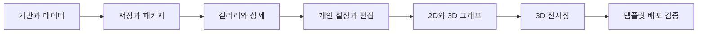

# 포트폴리오 전시장 구현 작업 계획

[기술 설계](./technical-plan.md)에 따라 공통 데이터부터 관람 화면, 개인 설정과 3D 기능을 구현한다. 기반과 데이터, 저장과 패키지 및 갤러리와 상세 구현을 완료했다. 개인 설정과 작품·구조 목록 편집도 구현했다. 2D·3D 아키텍처 탐색도 구현했다. 3D 전시장도 연결했다. 빈 템플릿, 콘텐츠 반영과 빌드 검사 및 Pages 워크플로와 안내도 구현했다. 실제 GitHub 배포와 다른 계정 재사용은 후속 확인 대상이다. 첫 공개 버전의 범위에는 갤러리, 작품 상세, YouTube, 2D 및 3D 아키텍처, 3D 전시장과 개인 설정 및 내보내기가 포함된다.

기능을 추가할 때마다 완료 기준을 확인한다. 전체 기능이 완성되기 전에도 관람과 편집의 작은 흐름을 연결해 확인하지만, 미완성 화면을 최종 플랫폼으로 공개하지 않는다.

## 단계와 의존 관계

## 기반과 데이터

### 작업

- 지원되는 Node 환경과 의존성 버전을 확인하고 React, TypeScript와 Vite를 구성한다.
- 현재 정적 초안을 보존하고 새 플랫폼 파일 구조를 만든다.
- 스키마의 자료 타입, 빈 workspace와 작품 생성 함수를 만든다.
- Ajv Draft 2020-12와 형식 검사를 연결한다.
- R01부터 R14까지의 참조 및 관계 검사를 구현한다.
- 공개 대상 작품과 그래프 및 자산을 정리하고 R15를 검사한다.
- 갤러리, 상세, 전시장과 설정 주소의 기본 라우터를 만든다.

### 완료 기준

기존 예시 3개가 새 검증기에서 같은 판정을 받는다. 중복 작품 ID, 잘못된 노드 연결과 부모 순환을 검출하고, 정상적인 일반 연결 순환은 허용한다. 공개 정리가 원본 자료를 바꾸지 않으며 초안과 미확인 그래프를 제외한다. 공개하지 않은 자료만 있으면 정상적인 빈 public 자료를 생성한다.

### 확인할 한계

Ajv의 strict 모드 컴파일, 세 예시의 브라우저 판정 및 TypeScript 검사를 확인했다. 공개 조건의 중첩 스키마에 object와 array 타입을 명시했고 기존 Python 경계 검사 26개를 다시 통과했다. 저장·패키지 단계에서 R10의 파일 실물 검사도 연결했다.

## 저장과 패키지

### 작업

- workspace, pendingInputs, 편집 상태와 자산의 IndexedDB 저장 구조를 만든다.
- siteKey와 workspaceId로 다른 배포 경로의 초안을 구분한다.
- transaction 완료에 기반한 저장 상태와 오류 복구를 만든다.
- 백업 메타데이터와 export-manifest의 JSON Schema를 추가한다.
- 실제 이미지 검사와 경로 및 파일 목록 검사를 연결한다.
- 전체 초안 백업, 공개 콘텐츠 내보내기와 전체 교체 가져오기를 만든다.
- 가져오기 미리보기와 현재 자료 보존 및 교체 확인을 만든다.

### 완료 기준

작품과 이미지를 내보내고 다시 가져오면 같은 자료를 복원한다. 잘못된 영상 주소의 원문도 초안 백업에서 유지한다. 누락 파일이나 잘못된 연결이 있으면 현재 초안을 유지한다. 저장 실패와 저장 중 추가 편집을 구분한다. 공개 패키지에 초안과 사용하지 않는 자산이 없다.

## 갤러리와 작품 상세

### 작업

- 공개 자료 및 편집 미리보기의 공통 공급자와 조회 함수를 연결한다.
- 프로필, 테마, 갤러리 카드와 빈 상태를 만든다.
- 작품 상세의 영상, 제작 정보, 개인 기여와 개발 기록을 만든다.
- YouTube ID 입력과 주소 정리, 지연 로드 및 재생 종료를 연결한다.
- 상세 직접 접근, 이전 및 다음 작품과 갤러리 복귀를 구현한다.
- 모바일 배치와 키보드 및 포커스 동작을 확인한다.

### 완료 기준

프로필과 작품 자료를 바꾸면 코드 수정 없이 다른 전시장이 표시된다. 0개와 여러 작품이 정상적으로 표시된다. 상세 주소를 직접 열고 새로고침해도 해당 작품을 찾는다. 영상을 떠난 뒤 소리가 남지 않는다. 실제 영상 URL이 없으면 준비 중 상태를 표시한다.

### 콘텐츠 조건

영상 재생 검증은 실제 프로젝트 영상이 등록된 뒤 수행한다. 영상 자료를 받기 전에는 플레이어 상태와 주소 정리 및 종료 동작을 검사하고 실제 프로젝트 영상 검증은 미완료로 남긴다.

## 개인 설정과 편집

### 작업

- 기본 정보, 작품 목록, 작품 편집과 전시 설정 폼을 만든다.
- 잘못된 입력 원문과 마지막 유효 자료를 분리한다.
- 추가, 삭제, 공개 선택과 순서 변경을 공통 자료에 연결한다.
- 시스템과 연결선의 목록 편집 폼을 만든다.
- 관람 미리보기와 설정 화면 복귀를 연결한다.
- 저장, 백업, 공개 내보내기와 배포 안내를 실제 패키지 기능에 연결한다.

### 완료 기준

친구가 코드 편집 없이 이름과 첫 작품을 입력하고 미리 볼 수 있다. 단계 이동과 미리보기 복귀 후 값이 유지된다. 작품 순서를 바꾸어도 편집 원문이 다른 작품으로 이동하지 않는다. 초안 저장, 내보내기와 실제 공개가 구분되어 표시된다.

## 아키텍처의 두 보기

### 작업

- 실제 자료와 예시 자료의 표시를 구분한다.
- 그룹과 부모 관계를 이용한 안정적인 2D 배치를 만든다.
- 노드, 연결 라벨, 담당 강조와 시스템 설명을 연결한다.
- 공통 Three.js 렌더러 호스트와 자원 관리 계층을 만든다.
- 그룹 layer에 기반한 3D 그래프와 카메라 조작을 연결한다.
- 보기 전환, 노드 삭제와 3D 실패에 대한 상태 처리를 만든다.

### 완료 기준

2D와 3D에서 같은 노드와 설명을 선택한다. 담당 강조 기준이 일치한다. 전환 후 선택 노드가 유지되고 3D 실패 시 2D와 시스템 목록을 사용한다. 실제 자료가 없는 작품은 기획 예시를 실제 구조로 표시하지 않는다.

### 콘텐츠 조건

예시 그래프로 렌더링과 상호작용을 확인할 수 있다. 실제 프로젝트 그래프의 공개 완료는 코드나 설명에 근거한 확인 자료를 받은 뒤 판정한다.

## 3D 전시장

### 작업

- 공개 작품 목록으로 전시실과 작품 패널을 구성한다.
- 로비, 전시 지점 이동, 드래그 시점과 작품 바로가기를 만든다.
- 작품 선택과 일반 상세 화면을 연결한다.
- 상세 진입 중 렌더링 중지와 이전 공간 복귀를 연결한다.
- 여러 전시실과 필요한 자원만 불러오는 처리를 만든다.
- 모바일 조작, 동작 줄이기와 WebGL 실패 복구를 확인한다.

### 완료 기준

작품 수 0개, 1개, 3개와 10개에서 접근 경로가 성립한다. 전시장과 3D 그래프가 동시에 활성 루프를 돌리지 않는다. 반복 전환 후 이벤트나 자원이 계속 증가하지 않는다. 공간에서 상세를 열고 돌아오면 해당 작품 구역을 복원한다.

## 템플릿과 공개 배포

### 작업

- 빈 전시장을 템플릿 기본 데이터로 제공한다.
- 공개 콘텐츠를 검증하고 dist만 생성하는 빌드를 만든다.
- GitHub Actions와 Pages 설정 안내를 만든다.
- 템플릿 복제, 데이터 반영과 첫 배포의 안내를 작성한다.
- 루트 base와 저장소 하위 base의 파일 접근을 확인한다.
- 실제 다른 계정의 독립 사이트에서 재사용 흐름을 확인한다.
- 앱 및 자료 버전과 개인 자료를 보존하는 업데이트 안내를 작성한다.

### 완료 기준

템플릿을 복제하고 이름과 작품을 바꾼 별도 사이트가 자기 주소에서 동작한다. 최초 사용자의 이름, 예시 프로젝트와 개인 연락처가 남지 않는다. dist에 기획 문서, 명세 예시와 초안 백업이 없다. 영상과 그래프의 실제 작품 자료까지 확인한 경우 첫 공개 버전의 완료로 판단한다.

### 외부 조건

실제 저장소와 배포 주소가 아직 없으므로 현재는 배포를 완료한 상태가 아니다. 구현 중에는 로컬 빌드와 두 base 경로를 확인하고, 실제 GitHub 저장소를 연결한 뒤 최종 배포와 다른 계정 재사용을 확인한다.

## 현재 작업 상태

2026-10-10 구조 정리 시작: Controller의 순수 편집 규칙과 저장 조율을 분리하고 설정 화면을 기능별 컴포넌트로 나눈다. 형식 검사·린트와 공통 파일 정책 및 하위 계층 의존을 정리한다. 수정 범위는 domain/packages/storage, studio 구성, 도구 설정과 CI 및 기존 회귀 검사다. 제공된 목록에서 같은 프로젝트의 다른 채팅은 확인되지 않았다. 공개 콘텐츠와 실제 초안을 변경하지 않으며 저장 충돌·복구·그래프 왕복 검사를 유지한다.

2026-10-10 우선 개선 시작: 일반 저장의 저장본 버전 비교와 명시적 가져오기 교체를 분리하고 읽기 실패 복구 상태를 보호한다. 이후 그래프의 최신 시점 저장과 회귀 검사·브라우저 CI 검사를 연결한다. 수정 범위는 storage, studio 복구/충돌 UI, graph session, 이미지 정책, tests/e2e, 관련 문서다. 제공된 목록에서 같은 프로젝트의 다른 채팅은 확인되지 않았다. 실제 사용자 초안과 공개 콘텐츠를 검증 입력으로 교체하지 않는다.

2026-10-10 전체 구조 평가 진행: domain/packages/storage/content/features/three/scripts의 의존·저장 안전성·화면 수명과 배포 검증을 확인한다. 실행 코드 변경 없이 재현 검사와 docs/structure-review.md, 관련 작업 기록을 작성한다. 제공된 목록에 같은 프로젝트 경로의 다른 채팅은 없었다. 다음은 데이터 보존 문제와 그래프 상태 복원의 개선 우선순위 확정이다.

2026-10-10 템플릿 배포 준비 시작: 빈 공개 콘텐츠, 공개 ZIP 반영/파일 검증 도구, 빌드 출력 제한, GitHub Actions와 재사용·업데이트 안내를 연결한다. 수정 범위는 scripts, site-content, .github/workflows, vite.config.ts, 공통 패키지 파일 읽기, 설정의 배포 안내, 관련 tests와 문서다. 제공된 최근 목록에는 같은 경로의 다른 채팅이 없었다. Git 저장소/배포 주소는 없으며 실제 업로드와 배포는 이번 로컬 검증에 포함되지 않는다.

2026-10-09 전시장 작업 시작: 방당 6작품 배치, 작품 패널·이동 지점·로비·시점 조작, 상세 진입/구역 복귀, 동작 줄이기·실패 복구를 연결한다. 수정 범위는 src/features/exhibition, src/three/RendererHost·ExhibitionScene, 탐색 복귀와 상세, 관련 tests다. 제공된 최근 목록에서는 같은 경로의 다른 채팅이 확인되지 않았다. 실제 게임 이미지·성과를 추정해 채우지 않으며 검증용 전시장으로 흐름을 확인한다. 다음 단계는 템플릿 빌드·배포 안내다.

2026-10-07 그래프 작업 시작: 공통 배치·선택 상태, SVG 2D와 Three.js 3D, 시스템 설명·기여·관계·개발 사례 링크, 3D 호스트 수명과 실패 복귀를 연결한다. 수정 범위는 src/features/architecture, src/three, 작품 상세·복귀, 관련 tests와 패키지 버전이다. 제공된 최근 목록에서 같은 경로의 다른 채팅은 확인되지 않았다. 실제 프로젝트 구조를 추정해 채우지 않으며 기획 예시로 렌더링을 검증한다. 2026-10-10 전시장 완료: 공개/전체 조회로 방당 6작품 배치, 현재 방의 패널·이미지·바닥 이동 지점과 로비, 드래그 시점, 목록 선택과 상세 진입/복귀를 연결했다. 시점은 실제 카메라 값으로 저장하고 드래그 이후에도 복원한다. 시스템·수동 동작 줄이기와 최신 이동 요청 교체, 숨김 프레임 중지, WebGL 실패 시 목록 유지/재시도와 정리를 적용했다. 자동 검사 총 169개, TypeScript·루트/하위 경로 빌드와 실제 브라우저의 3작품/10작품·0개 상태·상세 왕복·카메라/설정 복원·실제 연결 손실·360px 접근을 확인했다. 실제 게임 이미지와 영상 자료는 아직 제공되지 않았다.

2026-10-10 템플릿 배포 준비 완료: site-content의 빈 공개 자료와 ZIP 검사/반영, 기존 파일 보존, Node 실제 이미지 디코딩과 공통 패키지 검증, 앱 정적 파일 제한, Vite 콘텐츠 플러그인과 dist 파일/바이트/HTML 경로 검사를 연결했다. 기본 브랜치만 배포하는 Pages 워크플로와 복제·첫 편집·배포·콘텐츠 보존 업데이트 안내를 작성했다. 자동 검사 총 182개, TypeScript와 두 base 빌드를 통과했다. 검증용 제작자 A/B를 임시 경로에만 준비해 같은 origin의 루트/하위 경로에서 서로 다른 이름·이미지·구조와 상세 새로고침 및 지연 로드 3D를 확인했다. 하위 경로 개발 콘텐츠와 기본 아이콘 중복 경로도 수정해 확인했다.

다음 작업은 실제 GitHub 저장소 연결·Actions 배포와 공개 주소 확인, 다른 계정의 독립 복제·배포 검증이다. 실제 이름·소개·프로젝트 이미지/영상·구조와 기여 자료도 받아서 공개할 내용을 확인한다. GitHub 저장소 URL을 요청했으며 답변 전에는 계정이나 저장소를 추정해 생성하지 않는다. [배포 안내](./github-pages-guide.md)와 [검증 기록](../spec/verification.md)에 절차와 범위를 기록했다.

2026-10-10 전체 구조 평가 완료: domain/packages/storage/content/features/three/scripts와 현재 검사를 확인하고 [평가 기록](./structure-review.md)을 작성했다. 기존 182개 검사와 루트 빌드는 다시 통과했으나 독립 메모리 DB에서 탭 간 저장 덮어쓰기·읽기 실패 후 빈 저장본 교체를 재현했다. 별도 브라우저의 기획 예시에서 2D 확대값과 3D 시점의 화면 왕복 초기화를 재현했다. 실행 코드 수정은 이번 평가에 포함하지 않았다. 다음 개선 우선순위는 저장본 보존과 충돌 검사, 그래프 상태 복원 및 브라우저 회귀 검사다. 실제 GitHub 연결과 콘텐츠 검증은 기존의 외부 확인 항목으로 유지한다.

2026-10-10 우선 개선 완료: 일반 저장/가져오기 교체를 분리하고 저장본 token의 트랜잭션 비교, Controller 연속 저장, 충돌 시 입력·백업 보존과 확인 후 다시 읽기를 연결했다. 최초 읽기 실패 상태의 저장을 막고 재시도 및 파일 복구를 연결했다. 기존 commitId 없는 저장본의 호환과 HMR 입력 보존도 적용했다. 그래프의 최신 camera/box 종료 저장과 모드별 세션, 공통 픽셀 한도, 화면 위치만 바꿀 때 revision 유지도 반영했다. 자동 검사 195개, Chromium 회귀 검사 7개와 TypeScript 및 루트/하위 경로 빌드를 확인했다. Pages 워크플로에 브라우저 검사도 배포 전 조건으로 추가했다. site-content와 실제 사용자 초안은 바꾸지 않았다.

남은 개선은 실제 저장소·다른 계정 배포 확인과 낮은 우선순위의 Controller/화면 분리, 포맷터·린터, 공통 파일 정책, 성능 분석·공유 메타데이터다. 이번의 높은 우선순위 문제 수정과 이후 구조 정리를 구분한다.

2026-10-10 구조 정리 완료: edit-commands로 편집 명령을 분리하고 Controller는 저장과 작업 상태를 맡게 했다. 프로필·전시 설정·작품 목록·배포 안내와 사례 편집을 독립 컴포넌트로 분리했다. domain의 PendingInput/영상 정규화와 packages/policy의 공통 경로·한도도 정리했다. Prettier/Oxlint와 기본 Hook/계층 경계 검사, CI check 조건을 도입했다. Node 검사 197개와 Chromium 검사 8개, 형식·린트·타입과 루트/하위 경로 빌드를 통과했다. 공개 콘텐츠를 형식 정리 범위에서 제외했고 실제 초안·자료 버전도 유지했다.

다음 작업은 번들과 큰 자료의 성능을 측정해 개선하고, 전시장 공유용 메타데이터를 연결하는 것이다. 실제 GitHub 배포는 저장소 URL 연결 후 확인한다.

2026-10-10 초기 로딩·공유 개선 시작: 프로덕션 초기 JS와 실제 요청을 측정하고 화면별 지연 로드와 공개 로더 의존을 정리한다. 공개 콘텐츠에서 정적 Open Graph/공유 이미지와 작품별 공유 HTML을 생성하고 Pages 실제 base_url을 연결한다. 수정 범위는 app/content/packages, scripts·Vite·CI와 tests/e2e 및 배포 안내다. 제공된 목록에 같은 경로의 다른 채팅은 없었다. 실제 초안·site-content는 유지하며 검증 자료는 임시 경로에서만 사용한다.

2026-10-10 초기 로딩·공유 개선 완료: 상세/전시장 route 지연 로드와 실패 복귀, ZIP JSON/manifest 분리, Schema standalone 빌드 생성과 초기 JS 예산 검사, 정적 Open Graph/1200×630 JPEG·공개 작품별 공유 HTML·링크 복사를 연결했다. Actions에 실제 Pages base_url과 한국어 글꼴을 추가했다. 초기 static JS 합계 gzip 139,847→94,498 bytes로 약 32.4% 감소했다. Node 202개/Chromium 13개 및 형식·린트·타입과 root/subpath 빌드·dist·예산을 통과했다. 기존 공개 자료와 실제 초안은 유지한다.

다음은 저장소 URL을 연결한 실제 Actions·공개 사이트 및 다른 계정 배포/메신저 카드 확인, 실제 프로젝트 콘텐츠 검증이다. 별도 성능 확대 작업은 큰 그래프/ZIP·이미지와 실제 모바일 기기의 측정을 진행한다.

2026-10-10 큰 자료 성능 개선 시작: 50/200노드·다수 연결의 2D/3D 생성/조작, 고해상도 이미지 검사와 약 24MiB 이미지 ZIP 가져오기/내보내기의 전체 시간과 이벤트 루프 지연을 동일 조건에서 측정한다. 측정 후 그래프 반복 계산·텍스처와 이미지 검증·ZIP의 주 스레드 작업을 개선한다. 수정 범위는 architecture/three/packages 및 성능 harness·tests/e2e·빌드 검사·관련 문서다. 제공된 목록에는 같은 프로젝트의 다른 채팅이 없었으며 실제 초안/site-content는 검증용 데이터로 교체하지 않는다.

2026-10-10 큰 자료 성능 개선 완료: 동일 조건의 50/200노드·PNG/16MP JPEG·약 24MiB ZIP에서 측정했다. 2D 도형/인덱스 재사용, 큰 그래프 편집 폼 지연 생성/공통 선택 목록, 3D label atlas/선·화살표 묶기/Instance 종료, 불변 Blob 검사 재사용/실패 재시도와 큰 ZIP Worker 및 단일 압축/재검사를 연결했다. 편집 생성 약 399→3ms, 라벨 픽셀 추정 약 304→52MiB, draw calls 2420→1033이다. ZIP 전체 완료 및 첫 render 호출의 증가는 반응성 개선과 구분해 기록했다. Node 209개/Chromium 18개, 형식·린트·타입과 root/subpath 빌드·dist·초기 JS 예산을 통과했다. 원본 site-content/manifest와 사용자 초안을 유지했고 초기 JS는 382.1KiB/gzip 92.3KiB다.

후속 확인은 실제 모바일/다른 브라우저 GPU·상한 근처 자료, 실제 GitHub 저장소/독립 계정 배포와 프로젝트 콘텐츠 검증이다. 이번 범위의 측정·개선은 완료했다.

2026-10-12 실제 콘텐츠·배포 연결 준비 시작: 확인된 세 작품의 제목/장르/역할만으로 로컬 가져오기 초안과 SpaceShipThree 자료 작성 항목을 준비한다. 개인 초안은 .portfolio-drafts에 두고 Git/공개 빌드에서 제외한다. 수정 범위는 .gitignore, 로컬 개인 초안과 공통 작업 기록이다. 제공된 목록에 같은 프로젝트의 다른 채팅은 없었다. 현재 Git 연결/공개 작품은 없으며 저장소 URL과 실제 미디어/기술/기여 자료를 요청했다. URL 답변 전에는 원격 저장소·공개 주소를 추정해 생성하거나 배포하지 않는다.

2026-10-12 실제 콘텐츠 초안 준비 완료: .portfolio-drafts/2026-10-12에 확인된 세 작품의 draft JSON·workspace 백업 ZIP과 SpaceShipThree 자료/가져오기 안내를 저장했다. ZIP/JSON 재가져오기에서 세 작품·원본 데이터·초안 상태와 이미지/구조 0개를 확인했다. 개인 폴더를 Git에서 제외했으며 site-content와 브라우저의 초안은 바꾸지 않았다. 형식·린트·타입, 기존 Node 209개와 root 빌드/dist/초기 JS 예산을 재확인했다. 이번에는 UI 코드를 수정하지 않아 브라우저 18개를 재실행하지 않았다(2026-10-10 통과 기록과 구분).

현재 다음 작업에 필요한 값은 GitHub 저장소 URL, 공개할 제작자 이름과 SpaceShipThree의 실제 자료 위치·영상/이미지·코드 링크다. 비동기 질문으로 요청했으며 응답 전에는 원격을 추정하거나 공개하지 않는다. 입력을 받으면 실제 콘텐츠 작성/검증과 저장소 연결·Actions/Pages 배포를 이어간다.

2026-10-13 밝은 디자인·동작 애니메이션 시작: 밝은 공통 색상 토큰과 카드/폼/도구막대·3D/공유 카드 색상을 맞추고, 화면 전환/입력/선택/추가·순서 변경/상태 알림/대화상자·펼침에 이벤트 기반 모션을 적용한다. 동작 줄이기와 기존 입력/저장/시점·큰 자료 성능을 유지한다. 수정 범위는 app CSS/motion/theme, 기본 공개 theme와 바이트 manifest, 3D/공유 카드 팔레트, 관련 tests/e2e 및 기록이다. 제공된 목록에 같은 경로의 다른 채팅은 없었다. 실제 프로젝트 자료와 사용자 초안은 시험 자료로 교체하지 않는다.

2026-10-13 밝은 디자인·동작 애니메이션 완료: 공통 CSS 토큰/카드·폼·도구막대와 3D/공유 이미지 색상을 맞추고 새 초안·기본 공개 preset을 light로 변경했다. 이벤트 기반 클릭/키보드·입력/오류·메뉴 전환·선택·추가·순서/상태·대화상자/펼침/미리보기 모션, 채널별 취소/종료와 reduced-motion 중지를 적용했다. Node 211개, 기존 브라우저 18개+새 모션 3개, 형식·린트·타입과 두 base 빌드/dist/초기 예산을 확인했다. 마지막 모션 검사는 선택자 수정 후 따로 3개 재실행했다. 사용자 입력을 시험 자료로 교체하지 않았고 비어 있는 현재 화면을 확인한 뒤 5173 공개 콘텐츠 캐시를 재시작해 반영했다. 현재 원래의 작품 관리 화면에 밝은 UI를 표시한다.

2026-10-14 프로젝트 구성 문서 작성 완료: 실제 src·scripts·Schema·배포 및 테스트 설정을 확인해 [전체 구조와 기능 구성](./project-structure.md)을 작성하고 README에 연결했다. 디자인 설명을 제외하고 계층·폴더·주소·데이터·편집/관람 흐름·저장 안전성·패키지·3D 실행·빌드/공유/배포와 남은 운영 항목을 정리했다. 조회된 목록에서 같은 프로젝트의 다른 채팅은 없었다. 수정 범위는 해당 문서·README·본 기록이며 실행 코드와 공개 자료·사용자 초안은 변경하지 않았다. 상대 링크 9개·코드 블록 짝·주요 모듈 경로와 설정을 확인했다. 문서만 변경해 앱 테스트·빌드는 재실행하지 않았다. 이후 구현 변경 시 이 문서도 실제 구성에 맞춰 갱신한다.

2026-10-14 갤러리 글래스모피즘 시안 3개 작성: 기존 갤러리를 브라우저에서 확인·캡처하고 그 이미지를 각 Image Gen 요청에 첨부했다. 확인된 세 작품의 이름·장르·역할을 사용하고 실제 게임 이미지 대신 시안용 추상 비주얼임을 표시했다. 채팅에 표시된 순서대로 1은 프로스트 글래스의 균등 3열, 2는 오로라 글래스의 대표작 강조, 3은 뮤지엄 글래스의 소개/전시 목록 분할 구성이다. 결과는 로컬 generated_images/01a10fd5-d931-7ea3-a634-706d2d95404b 아래 exec-919569a9-1b74-4f99-bbaf-89f2e4dbd2c1.png, exec-5549a890-d258-40a8-8f35-061bb3d5820e.png, exec-0a307083-d000-41e4-9732-77360c4a795d.png에 보관된다. 제공된 채팅 목록에 같은 프로젝트의 다른 채팅은 없었다. 수정 파일은 본 작업 기록뿐이며 앱 코드·공개 콘텐츠·사용자 초안은 변경하지 않았다. 중지된 로컬 서버를 5173에서 재개해 기존 갤러리를 확인했다. 다음 작업은 사용자 선택 시안을 기준으로 구현하거나 요청한 부분을 재시안화하는 것이다. 이미지 시안이며 실행 화면 검증이나 성능 검증을 완료한 구현으로 취급하지 않는다.

2026-10-14 오로라 글래스 전체 적용 시작: 사용자가 표시 순서 2번 시안을 선택하고 상세·편집 화면 확장과 몽환적 분위기를 요청했다. 선택한 원본 exec-5549a890-d258-40a8-8f35-061bb3d5820e.png를 확인하고 같은 구성을 더 몽환적으로 다듬은 exec-c8ec4322-0561-439d-b73f-ae3fd1749cea.png를 생성·표시했다. image-to-code 스킬의 병렬 자산 제작 지침에 따라 배경 생성만 하위 에이전트에 맡겼으며 소스 편집·브라우저·배포는 위임하지 않았다. 수정 범위는 갤러리 구성·공통 스타일·실제 장식 배경·색상·브라우저 회귀 검사와 관련 기록이다. 실제 게임 콘텐츠·사용자 초안·공개 작품 수는 유지한다. 조회 목록에 겹치는 같은 프로젝트 채팅은 없었다. 다음은 구현, 독립 검증 자료로 화면 비교와 기능·빌드 검사다.

2026-10-14 오로라 글래스 전체 적용 완료: 갤러리의 대표작/두 작품 구성·유리 캡션, 상세 본문·섹션 탐색과 편집 입력·도구막대·대화상자에 공통 스타일을 적용했다. 실제 생성한 배경 WebP 20,728 bytes와 모바일/미지원·reduced transparency 처리를 추가하고 기존 모션·digital·데이터를 유지했다. 수정 파일은 main/Gallery/aurora CSS·배경 자산·light 3D palette·index meta, dist 검사와 기존 배포/모션 검사, README·기술/검증/본 기록 및 design-qa.md다. Node 211개·Chromium 전체 21개와 최종 모션 3개, 형식·린트·타입 및 root/subpath 빌드·dist·초기 예산을 통과했다. 전체/부분 시안 비교 후 제목/위치·작은 글자·중복 설명·유리 캡션을 수정하고 재비교했다. 별도 origin에서만 검토 자료를 사용했으며 실제 5173 입력과 공개 작품 0개를 유지했다. 현재 로컬 작업 공간은 최신 스타일로 제공한다. 다음은 실제 프로젝트 미디어·소개 입력 및 기존에 남은 저장소 연결·공개 배포 검증이다.

2026-10-14 가독성 검토: 사용자가 글래스 디자인의 글자 가독성 개선 방향을 요청해 현재 갤러리와 기본 정보 입력 화면을 새로 캡처했다. 큰 제목은 선명하며 편집 도움말·도구막대 12px, 항목명 13px/400, 입력 14px/400과 본문 면 90%·입력 면 94% 흰색을 실제 computed style로 확인했다. 우선 제안은 작은 기능 문구 14px 이상, 본문 16px, 항목명 굵기 강화와 불투명한 텍스트·안정된 배경 면 유지다. 현재 공개 작품이 없어 실제 이미지 위 캡션의 대비와 모든 배경 상태는 검증하지 않았다. WCAG 2.2의 일반 글자 4.5:1/큰 글자 3:1 기준을 참고했다. 결과는 채팅의 두 화면 비교와 제안으로 제공하며 앱 코드는 수정하지 않았다. 사용자 입력은 그대로 두고 갤러리로 복귀한다. 다음 적용 시 실제 배경 합성 대비와 좁은 화면·텍스트 확대를 함께 확인한다.

2026-10-14 가독성 개선 시작: 승인한 제안에 따라 공통 기능 문구·도움말 14px 이상, 입력/본문 16px와 항목명 굵기를 적용하고 이미지 위 캡션의 배경 대비를 안정화한다. 수정 범위는 aurora.css와 검토/검증/작업 기록이며 저장·공개 데이터나 입력 처리 코드는 바꾸지 않는다. 제공 목록에 같은 프로젝트의 다른 채팅은 없었다. 다음은 독립 자료에서 이미지 캡션·좁은 화면·확대와 기존 입력/모션 회귀를 확인하는 것이다.

2026-10-14 가독성 개선 완료: aurora.css에서 도움말/작은 기능 문구 14px, 항목명 15px/600, 입력 16px·본문 행간/폭과 짙은 보조 글자, 약 95% 흰 캡션 토큰을 적용했다. 모바일 긴 작품명 줄바꿈을 발견해 1000px 이하 한 열·420px 이하 세로 카드로 보완했다. 실제 5173 입력은 변경하지 않았고 별도 5174 자료로 이미지 캡션·360/720px 배치를 확인했다. 캡션 최저 합성 대비를 계산하고 항목명/도움말 전후 캡처를 함께 확인했다. 전체 Chromium 21개·최종 입력/모션/모바일 3개와 check·root/subpath 빌드·dist·예산을 통과했다. CSS/문서 변경으로 Node는 재실행하지 않았다. 실제 200% 텍스트 확대는 도구에서 배율 변화를 확인하지 못해 검증 완료 범위에서 제외한다. 수정 파일은 aurora.css와 기술/검증/본 기록 및 design-qa.md다. 현재 사용자 자료와 공개 작품 0개는 유지하며 다음 운영 작업은 실제 미디어·프로필·저장소 연결과 배포 검증이다.
2026-10-19 공개 배포 시작: 사용자가 현재 오로라 글래스 디자인 그대로 GitHub Pages 공개를 요청했다. 로그인 계정 Sragon-000의 저장소 목록에서 이 프로젝트 저장소나 개인 대표 Pages 저장소는 확인되지 않았다. 개인 대표 주소와 Project_IO 하위 주소 중 배포 목적지를 질문했고, 답변 전에는 원격을 만들지 않는다. 수정 범위는 배포 연결·운영 기록이며 공개 콘텐츠는 현재 빈 전시장 그대로 유지한다. 같은 경로의 다른 채팅은 제공 목록에서 확인되지 않았다. 먼저 check·Node 검사·프로덕션 빌드·브라우저 회귀와 업로드 제외 파일을 확인한다.
