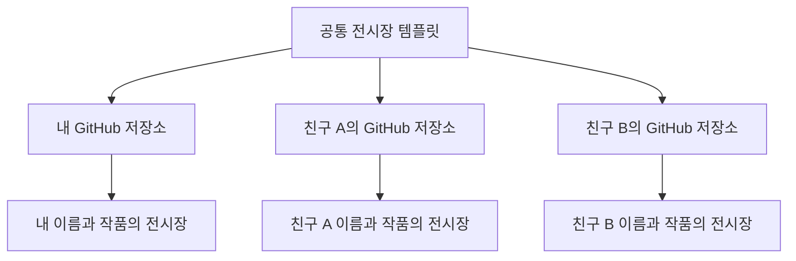
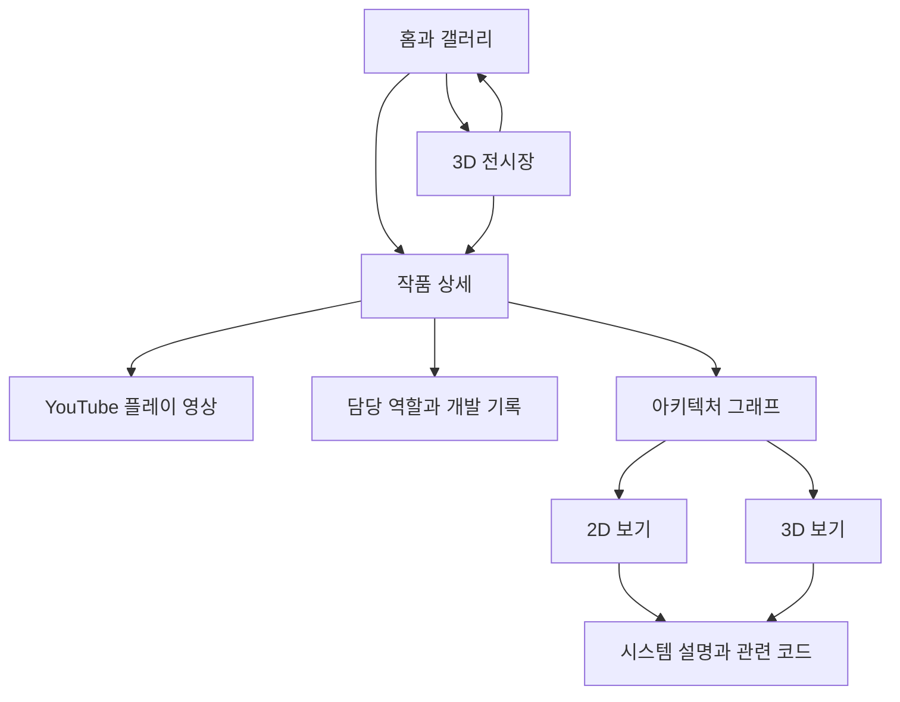

# 게임공학 포트폴리오 전시장 플랫폼 상세 기획 초안

대학 생활 동안 만든 게임과 개발 과정을 전시하는 포트폴리오 플랫폼이다. 친구들이 공통 사이트를 복제하고 자신의 이름과 작품을 넣어 각자의 GitHub Pages 주소로 운영한다. 방문자는 갤러리에서 작품을 빠르게 확인하거나 3D 전시장을 탐험하고, 같은 작품 상세 화면에서 플레이 영상과 개발 기록을 읽는다.

갤러리, 3D 전시장, YouTube 플레이어, 아키텍처 그래프와 개인별 재사용이 요청된 기능이다. 각자 사이트를 복제해 자신의 GitHub 주소로 운영하는 방식은 사용자 선택으로 확정했다. 아래의 화면 배치, 조작 방식, 설정 도구, 시각 방향과 제작 순서는 구현 전 검토할 제안이다. 현재 단계에서는 사이트 코드를 추가 구현하지 않는다.

## 플랫폼의 운영 방식

공통 기능을 제공하는 템플릿 저장소와 각 사용자의 독립적인 저장소로 구성한다. 사용자는 템플릿을 기반으로 저장소를 만들고 자신의 프로필과 작품을 등록한 뒤 GitHub Pages로 공개한다. GitHub의 템플릿 기능은 기존 저장소의 파일과 디렉터리 구조로 새 저장소를 만들 수 있다. [GitHub 템플릿 저장소 안내](https://docs.github.com/en/repositories/creating-and-managing-repositories/creating-a-repository-from-a-template)

이 플랫폼에서 전시장 주인은 복제한 저장소를 운영하는 사람이다. 표시 이름을 바꾸는 일은 GitHub 계정이나 저장소 주소를 바꾸는 일과 구분한다. 사용자의 개인 콘텐츠는 각자의 저장소에서 관리한다.

| 역할 | 관리 범위 |
| --- | --- |
| 템플릿 제작자 | 갤러리, 3D 전시장, 영상, 그래프와 설정 기능 |
| 각 전시장 주인 | 프로필, 작품, 미디어, 공개 자료와 자기 사이트 배포 |
| 관람객 | 공개된 작품 관람과 링크 이용 |

첫 공개 버전은 이 운영 방식에 맞춰 만든다. 여러 사용자가 한 사이트에 가입하는 계정형 서비스와 중앙 저장소는 별도 운영 모델로 남긴다.

## 개인화할 수 있는 항목

사용자는 사이트 코드를 수정하지 않고 프로필, 작품 데이터와 테마 설정으로 개인화한다. 같은 설정이 갤러리, 3D 전시장, 상세 화면과 문서 제목에 일관되게 반영되어야 한다.

| 설정 | 입력할 내용 | 반영 위치 |
| --- | --- | --- |
| 프로필 | 표시 이름, 소개, 관심 분야, 프로필 이미지 | 홈, 소개와 작품의 개인 기여 |
| 전시장 정보 | 전시장 이름, 짧은 설명, 기본 관람 모드 | 상단, 브라우저 제목과 전시 입구 |
| 공개 링크 | GitHub, 연락처와 기타 프로필 링크 | 소개와 하단 |
| 작품 | 이름, 장르, 역할, 설명, 전시 순서 | 갤러리, 공간과 상세 |
| 미디어 | 표지, 스크린샷, YouTube 영상 | 카드, 전시 패널과 상세 |
| 기술 자료 | 노드, 연결과 담당 시스템 | 2D 및 3D 아키텍처 |
| 테마 | 미리 정한 배경과 강조색 조합 | 공통 UI와 전시장 |
| 공개 여부 | 작품별 초안 또는 공개 | 공개 작품만 관람 화면에 표시 |

연락처와 이미지 등의 선택 항목을 비워도 레이아웃이 성립해야 한다. 초안 작품은 배포 자료에서 제외해야 하며, 화면에서 숨기는 것만으로 비공개 처리하지 않는다. 비공개로 남길 초안은 브라우저나 별도 비공개 자료로 관리하고 공개 저장소에 올리지 않는다.

프로필은 한 사이트에 한 명의 전시장 주인을 둔다. 팀 프로젝트의 팀원 정보와 공동 기여는 작품 데이터로 기록하며, 해당 팀원이 이 사이트의 운영자가 되는 것은 아니다.

## 친구가 전시장을 만드는 흐름

1. 템플릿 저장소에서 자신의 저장소를 만든다.
2. 기본 설정 화면에서 이름, 소개와 전시장 이름을 입력한다.
3. 작품을 추가하고 영상 주소, 역할과 개발 기록을 입력한다.
4. 제공하는 테마와 작품 순서를 선택한다.
5. 갤러리와 3D 전시장 미리보기를 확인한다.
6. 설정과 콘텐츠 파일을 내보내 자신의 저장소에 반영한다.
7. GitHub Pages를 활성화하고 공개 주소를 공유한다.

GitHub Pages의 사용자 사이트 주소는 `https://사용자명.github.io`, 프로젝트 사이트 주소는 `https://사용자명.github.io/저장소명` 형태다. 저장소 이름과 배포 경로가 달라져도 이미지, 영상과 내부 탐색이 동작하도록 설계한다. [GitHub Pages 주소와 유형](https://docs.github.com/en/pages/getting-started-with-github-pages/what-is-github-pages)

첫 배포에는 GitHub 저장소와 Pages 설정이 필요하다. 이 절차는 화면 예시가 있는 안내로 제공하고, 새 템플릿을 복제하는 것만으로 자동 배포되었다고 안내하지 않는다.

## 설정과 편집 화면

코드 편집에 익숙하지 않은 친구를 위해 브라우저에서 입력하고 미리 볼 수 있는 설정 도구를 첫 버전에 제안한다. 기본 정보, 작품, 전시 설정과 내보내기 순서로 구성한다. 최초 버전의 아키텍처는 노드와 연결을 입력하는 목록 폼으로 편집하며, 그래프에서 직접 선을 그리는 편집 기능은 이후 확장할 수 있다.

| 화면 | 주요 입력과 동작 |
| --- | --- |
| 기본 정보 | 이름, 소개, 전시장 이름과 공개 링크 |
| 작품 관리 | 추가, 수정, 삭제, 순서 변경과 공개 여부 |
| 작품 편집 | 소개, 역할, 영상과 문제 해결 사례 |
| 아키텍처 입력 | 시스템 이름, 책임, 담당 범위와 연결 관계 |
| 전시 설정 | 테마, 기본 관람 방식과 작품 배치 미리보기 |
| 미리보기 | 현재 입력값으로 갤러리와 3D 화면 확인 |
| 내보내기와 가져오기 | 설정 백업과 기존 콘텐츠 불러오기 |

설정 도구는 로컬 작업 공간이다. 공개 사이트 방문자가 입력해도 해당 방문자의 미리보기만 바뀌며, 실제 저장소의 콘텐츠는 바뀌지 않는다. 저장소 반영과 배포는 전시장 주인이 수행한다. 공개 관람 메뉴에는 편집 버튼을 넣지 않고 별도의 설정 주소와 안내에서 접근한다.

버튼은 의미를 구분해 표시한다. `미리보기`는 현재 입력을 화면에 반영하고, `이 기기에 초안 저장`은 브라우저에 저장하며, `파일 내보내기`는 저장소에 반영할 파일을 다운로드한다. 어느 동작도 공개 배포 완료로 표시하지 않는다. 브라우저 초안은 다른 기기로 동기화되지 않으므로 가져오기와 내보내기로 이동한다.

대표 이미지와 스크린샷은 선택한 실제 파일을 미리 보고, 내보낼 때 설정 데이터와 함께 패키지에 포함하는 방향으로 설계한다. 이미지의 파일명과 참조 경로가 일치하는지 검증한다. YouTube 영상은 영상 파일 대신 ID를 관리한다.

입력 검증은 작품 ID 중복, 잘못된 영상 주소, 없는 노드를 참조하는 연결선과 지원하지 않는 설정 버전을 확인한다. 실패 시 해당 항목과 수정 방법을 표시하고 기존 입력을 유지한다. 데이터 가져오기는 현재 내용을 덮어쓰기 전에 내용을 미리 보여주고 백업 경로를 제공한다.

## 재사용과 업데이트 원칙

공통 렌더링 기능, 개인 콘텐츠와 기본 테마를 분리한다. 개인 이름, 프로젝트 ID와 작품 수를 화면 코드에 고정하지 않는다. 처음 받은 세 작품은 첫 개인 전시장의 콘텐츠이며 플랫폼의 고정 작품이 아니다.

템플릿 배포본에는 빈 프로필과 명확한 예시 작품을 제공하고 개인 연락처와 실제 개인 프로젝트 자료를 기본값으로 복제하지 않는다. 예시를 지우고 작품이 없는 상태로 시작해도 오류가 없어야 한다.

템플릿으로 만든 사이트는 독립된 저장소다. 원본 기능의 수정이 각 개인 사이트에 자동 반영되는 업데이트 구조를 두지 않는다. 공통 기능의 버전과 콘텐츠 형식의 버전을 관리하고, 이후 기능 업데이트에는 개인 데이터를 보존하는 적용 안내를 제공한다.

자료 형식을 변경할 때에는 지원하는 이전 형식을 변환하고, 지원하지 않는 버전은 설명과 함께 가져오기를 중단한다. 공통 업데이트가 친구의 이름, 테마, 작품과 미디어를 기본 예제로 덮어쓰지 않도록 한다.

## 목적과 방문자

작품을 통해 게임을 완성하는 능력과 기술 문제를 해결하는 과정을 전달한다. 팀 프로젝트에서는 팀 전체의 결과와 개인의 구현 및 리더십을 구분한다.

플랫폼 사용자는 친구에게 전달받은 템플릿을 자기 포트폴리오로 만들 수 있어야 한다. 이름과 첫 작품 등록, 미리보기까지 사이트 코드를 수정하지 않는 흐름을 목표로 한다.

| 방문자 | 확인하려는 내용 | 우선 제공할 경로 |
| --- | --- | --- |
| 채용 담당자와 평가자 | 어떤 게임을 만들었고 무엇을 맡았는가 | 갤러리에서 작품 상세로 이동 |
| 개발자와 기술 면접관 | 시스템 구조와 설계 판단의 근거 | 담당 역할에서 그래프와 문제 해결 기록으로 이동 |
| 동료와 일반 관람객 | 어떤 게임이며 플레이가 재미있는가 | 3D 전시장과 플레이 영상 |

첫 방문자는 한 화면에서 작품 목록과 두 관람 방식을 찾을 수 있어야 한다. 게임 조작에 익숙하지 않아도 모든 포트폴리오 콘텐츠를 볼 수 있어야 한다.

## 확인된 작품과 필요한 자료

아래 작품은 첫 개인 전시장에 등록할 콘텐츠다. 친구의 사이트에는 친구가 등록한 작품과 역할을 표시한다.

| 작품 | 장르 | 확인된 역할 | 추가로 정리할 핵심 내용 |
| --- | --- | --- | --- |
| SpaceShipThree | 우주 탐험 게임 | 1인 개발 | 제작 범위, 핵심 플레이, 직접 구현한 시스템 |
| 난장판! | 모바일 AR 디펜스 게임 | 팀장 | 팀 규모, 개발 담당 범위, AR 사용 방식과 리더십 사례 |
| Eternal_Steam | 디펜스 게임 | 팀장 | 팀 규모, 개발 담당 범위, 디펜스 규칙과 리더십 사례 |

제작 연도, 엔진, 플랫폼, 팀 인원, 성과와 코드 구조는 자료를 받은 뒤 기입한다. 팀장 역할만으로 특정 시스템을 직접 개발했다고 판단하지 않는다. 작품명에서 우주선 조작 방식이나 스팀펑크 세계관 등을 추정해 소개하지 않는다.

공개 작품의 이름과 장르를 먼저 전시할 수 있지만, 영상과 기술 자료가 없는 구간은 준비 중 상태로 표시한다. 개발 중 사용하는 구조 예시는 공개 전에 실제 구조로 교체하거나 숨긴다.

## 정보 구조와 주소

홈의 기본값은 갤러리다. 별도 인트로 화면을 통과하지 않고 작품에 바로 접근한다. 상단에 갤러리와 3D 전시장 전환을 두고, 작품 상세는 두 모드가 공유한다.

기본 관람 모드는 설정으로 바꿀 수 있다. 플랫폼 기본값은 갤러리이며 설정 도구는 관람 흐름과 별도로 둔다.

| 화면 | 제안 주소 | 직접 열었을 때 |
| --- | --- | --- |
| 갤러리 | `#/gallery` | 작품 목록 표시 |
| 3D 전시장 | `#/exhibition` | 입구 시점에서 시작 |
| 작품 상세 | `#/projects/spaceshipthree` 등 | 해당 작품 상세 표시 |
| 설정 도구 | `#/studio` | 브라우저 초안 또는 가져온 데이터 편집 |

작품 식별자는 제목을 바꿔도 유지한다. 내부 주소는 해시 방식으로 설계하고 상대 경로로 파일을 연결해 사용자 사이트와 저장소 하위 주소를 함께 지원한다. GitHub Pages는 HTML, CSS, JavaScript를 배포하는 정적 호스팅 서비스이므로 서버 라우팅을 전제로 두지 않는다. [GitHub Pages 안내](https://docs.github.com/en/pages/getting-started-with-github-pages/what-is-github-pages)

## 관람 흐름

### 빠르게 작품을 확인하는 흐름

1. 홈에서 등록된 작품의 이름, 장르, 역할을 확인한다.
2. 관심 있는 작품을 선택한다.
3. 소개와 플레이 영상을 본다.
4. 담당 역할, 그래프와 문제 해결 기록을 확인한다.
5. 목록으로 돌아가 다른 작품을 본다.

### 3D 공간을 관람하는 흐름

1. 홈에서 3D 전시장 입장을 선택한다.
2. 짧은 조작 안내와 등록된 작품의 바로가기를 확인한다.
3. 전시 구역을 선택하거나 공간을 둘러본다.
4. 작품의 전시 패널을 선택해 상세 화면을 연다.
5. 상세 화면에서 돌아오면 이전 전시 위치를 유지한다.
6. 언제든 갤러리로 이동한다.

### 기술 구조를 확인하는 흐름

1. 작품 상세에서 아키텍처 영역으로 이동한다.
2. 2D 그래프의 범례와 주요 시스템을 확인한다.
3. 직접 담당한 시스템을 강조하거나 노드를 선택한다.
4. 역할, 연결 이유, 문제 해결 사례와 코드 근거를 읽는다.
5. 3D 보기로 전환해 같은 구조를 공간에서 살펴본다.

## 갤러리 화면

첫 화면은 간결한 소개와 작품 카드에 집중한다. 데스크톱에서는 한 행에 최대 세 카드를, 모바일에서는 한 열로 배치한다. 작품 수에 따라 행을 늘리고 0개, 1개와 여러 작품 상태를 지원한다. 첫 버전에서는 검색과 필터를 넣지 않는다.

| 영역 | 표시 내용 | 동작 |
| --- | --- | --- |
| 상단 | 전시장 이름, 갤러리, 3D 전시장, 개발자 소개 | 현재 모드 표시와 전환 |
| 소개 | 전시장 주인의 이름과 직접 작성한 설명 | 짧게 읽고 작품으로 이동 |
| 작품 카드 | 실제 스크린샷, 작품명, 장르, 역할 | 선택하면 작품 상세 |
| 하단 소개 | 개발 관심 분야와 공개할 연락처 | 자료가 있는 항목만 표시 |

카드에는 한 줄로 설명할 핵심 플레이를 넣는다. 실제 스크린샷을 확보하기 전에는 작품명과 장르를 읽을 수 있는 표지를 사용한다. 호버에만 정보를 숨기지 않는다.

스크린샷과 영상은 실제 플레이 자료를 사용한다. 전시장 연출과 작품의 실제 게임 화면이 혼동되지 않게 구분한다.

## 3D 전시장

### 공간 구성

작은 중앙 로비와 등록 작품에 맞춘 전시 구역으로 구성한다. 첫 개인 전시장은 세 작품 구역으로 시작한다. 첫 시점에서 작품 방향을 파악할 수 있도록 배치하고, 처음부터 모든 작품을 찾기 위한 긴 이동을 요구하지 않는다.

친구의 작품 수가 달라도 같은 공간 생성 규칙을 사용한다. 첫 버전은 전시실당 최대 여섯 작품을 배치하고 초과하면 다른 전시실로 나누는 방향으로 제안한다. 전시실을 이동할 때 해당 방의 자원을 로드한다. 작품이 없는 경우에는 비어 있는 전시장 안내를 표시하고 미등록 작품을 생성하지 않는다.

플랫폼의 사용자나 작품을 세 개로 고정하지 않는다. 관람 화면의 성능과 자료 용량을 고려해 방을 나누며, 실제 성능과 호스팅 조건을 확인하기 전에는 무제한 용량이나 동시 관람을 보장하지 않는다.

| 공간 | 주요 구성 | 제안 연출 |
| --- | --- | --- |
| 중앙 로비 | 등록 작품 안내, 이동 지점, 갤러리 전환 | 설정한 전시장 이름과 절제된 조명 |
| SpaceShipThree 구역 | 작품명, 우주 탐험 소개, 역할, 영상 포스터 | 실제 게임 자료를 받은 뒤 우주 분위기 반영 |
| 난장판! 구역 | 작품명, 모바일 AR 디펜스 소개, 역할, 영상 포스터 | 실제 AR 플레이 화면을 중심으로 전시 |
| Eternal_Steam 구역 | 작품명, 디펜스 소개, 역할, 영상 포스터 | 실제 게임 미술과 전투 장면을 바탕으로 전시 |

공간 안에서는 간단한 정보만 읽고, 긴 설명과 영상 재생은 일반 웹 상세 화면에서 제공한다. 3D 벽면 텍스트에 모든 기술 설명을 넣지 않는다.

### 조작 방식

첫 버전은 전시 지점을 선택해 이동하는 방식이 기본이다. 드래그로 주변을 살펴보고, 작품 바로가기로 각 구역에 이동한다. 자유 보행은 필요할 경우 이후 추가할 수 있다.

| 조작 | 데스크톱 | 모바일 |
| --- | --- | --- |
| 주변 살펴보기 | 마우스 드래그 | 한 손가락 드래그 |
| 전시 구역 이동 | 이동 지점이나 작품 바로가기 선택 | 이동 지점이나 작품 바로가기 터치 |
| 작품 열기 | 작품 패널 선택 또는 일반 버튼 | 작품 패널 터치 또는 일반 버튼 |
| 위치 초기화 | 입구로 돌아가기 버튼 | 동일 |
| 갤러리 전환 | 상단 모드 전환 | 동일 |

선택 가능한 전시 패널에는 시각적 강조와 작품명을 표시한다. 이동 애니메이션은 짧게 하고, 동작 줄이기 설정에서는 즉시 이동한다. 드래그로 시점을 바꾸는 동작과 클릭으로 작품을 선택하는 동작을 구분한다.

### 관람 상태와 복귀

상세 화면을 열면 3D 렌더링과 입력을 일시 중지한다. 돌아올 때 작품 구역과 시점을 복원한다. 작품 링크를 직접 연 방문자가 돌아가기를 선택하면 갤러리로 이동한다.

WebGL을 지원하지 않거나 로딩에 실패하면 이유와 갤러리 이동 버튼을 표시한다. 낮은 성능에서 모든 콘텐츠를 계속 볼 수 있도록 3D 진입은 선택 사항으로 유지한다.

## 작품 상세 화면

작품별로 링크를 공유할 수 있는 상세 화면을 둔다. 데스크톱에서는 본문과 섹션 이동 메뉴를 함께 표시하고, 모바일에서는 본문 한 열과 간단한 섹션 이동을 제공한다.

| 순서 | 영역 | 내용 |
| --- | --- | --- |
| 1 | 작품 개요 | 작품명, 장르, 핵심 플레이 한 줄, 역할 |
| 2 | 플레이 영상 | YouTube 플레이어와 영상 설명 |
| 3 | 프로젝트 정보 | 제작 기간, 플랫폼, 엔진, 팀 규모 |
| 4 | 담당 역할 | 직접 구현한 기능, 협업 범위, 리더십 |
| 5 | 아키텍처 | 시스템 관계와 개인 기여 |
| 6 | 문제 해결 기록 | 구체적인 기술 사례와 판단 근거 |
| 7 | 결과와 회고 | 확인 가능한 결과, 배운 점, 개선 방향 |
| 8 | 관련 자료 | 공개 가능한 코드, 문서, 빌드와 다음 작품 |

1인 개발 작품에서는 전체 제작 범위와 특히 깊이 있게 구현한 부분을 구분한다. 팀장 작품에서는 일정 조율, 의사결정, 협업 방식과 직접 작성한 코드를 분리해 소개한다.

문제 해결 사례는 작품당 1~3개를 우선 정리한다. 각 사례는 문제 상황, 검토한 대안, 선택한 해결책, 확인한 결과 순으로 작성한다. 성능 개선 수치는 측정 조건과 전후 결과가 있을 때만 표시한다.

## YouTube 영상

### 표시와 재생

작품별로 대표 플레이 영상 하나를 우선 제공한다. 상세 화면에 16대9 플레이어를 배치하고 사용자가 재생을 선택할 때 로드한다. 영상에는 실제 플레이와 핵심 기능을 이해할 수 있는 짧은 설명을 붙인다.

자동 재생은 기본적으로 끈다. 재생, 음량, 탐색, 전체 화면은 YouTube 기본 컨트롤을 사용한다. 모바일 인라인 재생은 `playsinline`을 적용한다. [YouTube 플레이어 설정](https://developers.google.com/youtube/player_parameters)

작품을 바꾸거나 상세 화면을 떠나면 플레이어를 정지 또는 제거한다. 영상 타임스탬프를 선택해 특정 기능 장면으로 이동하는 기능은 해당 자료가 있을 때 추가한다. 정지와 장면 이동에는 공식 IFrame API를 사용할 수 있다. [YouTube IFrame API](https://developers.google.com/youtube/iframe_api_reference)

### 연결과 실패 상태

영상의 ID와 제목을 작품 데이터로 관리한다. YouTube 영상 주소를 받으면 해당 ID로 연결하며, API 키를 이용한 영상 검색이나 채널 수집은 첫 버전에 포함하지 않는다.

| 상태 | 표시와 복구 |
| --- | --- |
| 영상 미등록 | 플레이 영상 준비 중 표시 |
| 로딩 중 | 비율이 고정된 플레이어 자리와 로딩 안내 |
| 정상 재생 | 플레이어와 영상 설명 |
| 임베드 제한 또는 삭제 | 재생 불가 안내와 원본 주소가 유효할 때 YouTube에서 보기 |
| 네트워크 또는 플레이어 초기화 실패 | 다시 시도와 원본 영상 링크 |

플레이어 실패가 소개, 그래프와 개발 기록을 가리지 않도록 영역을 독립시킨다. YouTube의 관련 영상이나 브랜딩을 완전히 제거할 수 있다고 기획하지 않는다. [YouTube 플레이어 설정](https://developers.google.com/youtube/player_parameters)

## 아키텍처 그래프

### 표현할 구조

기본 단위는 클래스 하나보다 역할을 설명할 수 있는 시스템이나 모듈이다. 첫 화면은 주요 노드 약 6~12개를 목표로 구성하고, 복잡한 시스템은 하위 구조를 펼쳐 확인한다. 노드 수는 실제 프로젝트 규모에 맞춰 조정한다.

노드는 시스템의 책임을, 연결선은 방향이 있는 관계를 표현한다. 호출, 데이터 전달, 이벤트 전달, 의존을 구분하고 연결선의 라벨과 범례로 뜻을 설명한다. 연결이 많을 때에는 선택한 노드와 직접 연결된 관계를 강조한다.

이 기획에 들어가는 시스템 이름이나 그래프 예시는 실제 게임 구조의 근거가 아니다. 프로젝트 코드와 설명으로 확인한 노드와 연결만 공개 그래프에 넣는다.

### 공통 기능

| 기능 | 동작 |
| --- | --- |
| 전체 보기 | 모든 주요 시스템을 화면에 맞춤 |
| 노드 선택 | 노드와 직접 연결된 관계 강조 |
| 시스템 설명 | 책임, 입력과 출력, 관련 시스템 표시 |
| 내 담당 강조 | 직접 구현한 시스템을 테두리와 담당 라벨로 구분 |
| 세부 구조 보기 | 선택한 시스템의 하위 노드가 있을 때 펼침 |
| 관련 코드 보기 | 확인된 저장소와 파일 링크 열기 |
| 2D와 3D 전환 | 같은 데이터와 선택 상태 유지 |
| 목록으로 보기 | 그래프 조작 없이 시스템 설명을 읽음 |

기여는 직접 구현, 공동 구현, 팀 구현 중 하나로 표시한다. 팀장이라는 이유로 모든 노드를 개인 구현으로 강조하지 않는다. 관련 코드가 비공개이면 공개 가능한 설계 설명만 제공한다.

### 2D 보기

일정한 방향으로 정렬해 흐름을 읽을 수 있게 배치한다. 데스크톱에서는 그래프 약 3분의 2와 설명 패널 약 3분의 1을 사용한다. 이동, 확대와 축소, 전체 맞춤을 제공한다.

모바일에서는 그래프 아래에 선택한 시스템의 설명을 표시한다. 노드 목록도 함께 제공해 작은 노드를 정확하게 터치하지 않아도 된다. 노드 이름을 생략하는 대신 줄바꿈과 그룹화를 이용한다.

### 3D 보기

실제 시스템의 그룹을 확인한 뒤 층이나 영역을 정한다. 2D의 동일한 노드와 연결을 3D 공간에 배치하며, 임의의 위치에서 계속 흔들리는 연출은 사용하지 않는다.

드래그 회전, 확대와 축소, 노드 선택, 전체 맞춤과 시점 초기화를 제공한다. 선택한 노드로 시점을 이동하고 연결된 관계를 강조한다. 텍스트 설명은 읽기 쉬운 일반 웹 패널에 둔다.

2D 보기와 3D 보기를 전환할 때 선택한 노드와 담당 강조 설정을 유지한다. 3D 전시장과 3D 그래프는 별도 공간이며 두 렌더러를 동시에 계속 실행하지 않는다.

### 근거와 최신성

그래프에 구조를 확인한 기준 버전이나 날짜를 기록한다. 저장소 링크와 파일 경로를 자료로 남기고, 프로젝트 업데이트 시 그래프 설명도 함께 검토한다. 첫 버전은 정리된 데이터를 수동 등록하며 코드 전체를 자동 분석하는 기능은 포함하지 않는다.

## 시각 방향

공통 공간은 어두운 바탕과 명확한 대비를 가진 디지털 전시장으로 제안한다. 작품의 실제 스크린샷이 가장 눈에 띄고, 공통 UI는 간결하게 유지한다. IO는 현재 작업 이름이며 공개 명칭은 추후 정할 수 있다.

이 방향을 기본 테마로 제공하고, 친구는 정해진 색 조합과 전시장 이름을 선택할 수 있다. 모든 화면은 테마 설정을 공통으로 참조한다. 로고와 파비콘은 기본 브랜드 자산을 제공하고 개인 자산이 있을 때 교체하도록 한다.

| 요소 | 제안 방향 |
| --- | --- |
| 공통 바탕 | 짙은 회색과 녹색 계열 |
| 주요 강조 | 밝은 라임 계열 |
| 작품별 구분 | 색과 함께 작품명 및 전시 번호 사용 |
| 글꼴 | 한글 가독성이 좋은 산세리프 |
| 카드 | 실제 플레이 화면을 크게 배치 |
| 3D 공간 | 단순한 형태, 절제된 조명, 작품 중심 배치 |
| 움직임 | 이동과 선택을 설명하는 짧은 전환 |

본문은 기본 16px 이상으로 읽기 쉽게 하고, 색만으로 담당 역할이나 선택 상태를 구분하지 않는다. 게임별 공간의 분위기는 실제 게임 자료를 기준으로 확장한다.

## 반응형과 접근성

| 항목 | 기준 |
| --- | --- |
| 모바일 | 360px 폭에서도 본문과 조작 버튼이 잘리지 않음 |
| 텍스트 확대 | 200퍼센트 확대 시 주요 콘텐츠와 탐색 사용 가능 |
| 키보드 | 갤러리, 모드 전환, 작품 상세, 시스템 목록 접근 가능 |
| 포커스 | 선택 위치가 보이고 화면을 닫으면 출발점으로 복귀 |
| 영상 | 작품별 플레이어 제목과 영상 설명 제공 |
| 이미지 | 실제 장면을 설명하는 대체 텍스트 제공 |
| 그래프 | 동일 정보를 시스템 목록과 관계 설명으로 제공 |
| 동작 줄이기 | 자동 회전, 카메라 이동과 불필요한 전환 축소 |
| 3D 미지원 | 갤러리와 모든 기술 설명 접근 가능 |

3D 장면만으로 메뉴나 작품을 선택해야 하는 상황을 만들지 않는다. 일반 버튼과 작품 목록을 함께 제공한다.

## 데이터 구조

프로필과 전시장 설정은 개인별 데이터로 분리한다. 작품 데이터 하나가 갤러리, 3D 전시장과 상세 화면의 기준이 된다. 그래프도 노드와 연결 데이터 하나를 두 렌더러가 공유한다.

| 개인 설정 | 필드 | 용도 |
| --- | --- | --- |
| 자료 버전 | schemaVersion | 가져오기와 형식 변환 |
| 프로필 | displayName, bio, avatar, interests, links | 이름과 소개 |
| 전시장 | title, description, defaultView | 사이트 이름과 기본 관람 모드 |
| 테마 | preset, accent, logo, favicon | 공통 스타일과 개인 자산 |
| 작품 구성 | projectOrder, project.status | 순서와 작품별 공개 상태 |

개인 데이터의 파일 구성은 `content/site.json`, `content/projects.json`, `content/architectures/`와 `assets/`로 제안한다. 렌더링 코드와 기본 테마는 별도 디렉터리에 둔다. 편집용 원본에는 초안이 있어도, 공개 출력에는 공개하기로 선택한 데이터와 자산만 포함한다.

정확한 필드와 검증 기준은 [데이터 형식과 입력 검증 기획](./data-contract.md)을 기준으로 한다. 작성과 가져오기는 portfolio.json 묶음 하나로 관리하고, 위 분리 파일 구성은 공개 출력에서 생성한다. 작품 공개 여부는 project.status에서만 관리한다.

| 묶음 | 필드 | 용도 |
| --- | --- | --- |
| 작품 기본 | id, slug, title, genre, summary | 안정적인 주소와 소개 |
| 제작 정보 | period, platform, engine, teamSize, role | 사실 기반 메타데이터 |
| 미디어 | cover, screenshots, videoId, videoTitle | 표지와 영상 |
| 개인 기여 | responsibilities, implementedSystems, leadership | 역할과 구현 범위 |
| 개발 기록 | overview, caseStudies, outcome, reflection | 설명과 문제 해결 사례 |
| 외부 자료 | repositoryUrl, documentUrls, buildUrl | 공개 가능한 근거 |
| 전시 연출 | zoneId, accent, exhibitAsset | 공간과 시각 구분 |
| 그래프 | revision, groups, nodes, edges | 2D와 3D의 공통 구조 |

| 그래프 항목 | 필드 | 용도 |
| --- | --- | --- |
| 노드 | id, label, group, responsibility | 시스템 이름과 역할 |
| 설명 | inputs, outputs, decisions, relatedCaseIds | 데이터와 설계 이유 |
| 기여 | contributionType, contributionNote | 직접 및 공동 구현 구분 |
| 근거 | codeRefs | 코드 버전, 경로와 공개 링크 |
| 하위 구조 | children | 시스템의 상세 구조 |
| 연결선 | id, source, target, type, label, description | 방향과 관계의 뜻 |

제작 시기와 팀 규모 등의 미확인 값은 비워둔다. 없는 정보를 0이나 임의의 이름으로 채우지 않는다. 연결선은 존재하는 노드 ID만 참조해야 한다.

## 기술 구성 제안

갤러리와 상세 화면은 일반 HTML 기반으로 만들고, 3D 전시장과 3D 그래프는 WebGL 렌더링을 별도로 로드한다. 2D 그래프는 SVG 기반으로 노드와 연결을 표시하는 방향으로 검토한다. 특정 프레임워크나 그래프 라이브러리는 화면 구성이 확정된 뒤 선택한다.

```mermaid
flowchart LR
  P[작품 데이터] --> G[갤러리]
  P --> E[3D 전시장]
  P --> D[작품 상세]
  A[그래프 데이터] --> V[2D 그래프]
  A --> W[3D 그래프]
  D --> V
  D --> W
  D --> Y[YouTube 플레이어]
```

외부 영상은 YouTube에서 재생하고, 사이트는 이미지와 그래프 데이터 등 정적 자료를 배포한다. 첫 버전의 편집 도구는 브라우저에서 초안을 만들고 정적 콘텐츠 파일로 내보낸다. 공개 업데이트는 각자의 GitHub 저장소에 해당 파일을 반영하는 방식이다.

설정 도구의 초안, 내보낸 파일과 실제 공개 콘텐츠를 별도 상태로 관리한다. 템플릿 제작자의 저장소나 다른 친구의 데이터에 접속하지 않아도 개별 사이트의 생성과 운영이 가능해야 한다.

배포 단계는 공개 대상의 콘텐츠와 자산만 전용 출력 폴더로 복사하고 그 폴더를 GitHub Pages에 배포하는 흐름으로 설계한다. 작성용 데이터 전체가 사이트의 정적 파일로 제공되지 않도록 출력 경로를 분리한다. 공개 저장소에 올라간 원본 파일 자체는 공개되므로, 비공개 초안의 보관은 브라우저나 별도 비공개 자료에서 수행한다.

## 성능 목표와 상태 처리

아래 수치는 제작 시 검증할 목표이며 현재 달성 결과가 아니다. 먼저 측정할 모바일 기기와 네트워크 조건을 정하고 수치를 기록한다.

| 항목 | 제안 목표 또는 동작 |
| --- | --- |
| 초기 갤러리 | 3D 라이브러리와 공간 모델을 로드하지 않음 |
| 영상 | 재생 선택 전에는 플레이어 초기화를 미룸 |
| 3D 진입 | 해당 모드를 선택할 때 자원 로드 |
| 3D 자료량 | 첫 공간의 압축 자원 합계 약 5MB 이내를 목표로 검토 |
| 렌더링 | 모바일 30fps 이상을 목표로 그림자와 해상도 조절 |
| 비활성 장면 | 다른 화면이나 브라우저 비활성 상태에서 렌더링 중지 |
| 중복 자원 | 작품을 다시 열어도 모델과 텍스처가 계속 쌓이지 않음 |
| 그래프 | 노드 수가 많으면 시스템별로 나누어 표시 |

| 실패 상황 | 사용자에게 제공할 복구 |
| --- | --- |
| 3D 자원 로드 실패 | 다시 시도, 갤러리로 보기 |
| WebGL 미지원 또는 컨텍스트 손실 | 안내와 갤러리로 보기 |
| 등록되지 않은 작품 주소 | 작품을 찾을 수 없음과 목록 이동 |
| 스크린샷 없음 | 제목을 읽을 수 있는 대체 표지 |
| 그래프 자료 없음 | 구조 자료 준비 중과 다른 상세 콘텐츠 |
| 일부 연결 데이터 오류 | 잘못된 연결을 제외하고 나머지 정보 표시 |

## 제작 단계와 완료 기준

요청된 기능은 최종 첫 공개 버전에 모두 포함하되, 각 단계를 확인하며 통합한다. 자유 보행, 자동 코드 분석, 웹에서 직접 게임 플레이는 이후 별도 범위로 검토한다.

| 단계 | 산출물 | 완료 기준 |
| --- | --- | --- |
| 1 개인 데이터 설계 | 프로필, 전시장, 작품과 그래프 형식 | 이름과 작품 수가 기능 코드에 고정되지 않음 |
| 2 콘텐츠와 화면 설계 | 첫 전시장 자료와 관람 및 설정 와이어프레임 | 개인 기여 확인과 모바일 흐름 검토 |
| 3 갤러리와 상세 | 공통 렌더링, 상세 링크, 영상과 개발 기록 | 서로 다른 두 프로필로 같은 기능 동작 |
| 4 아키텍처 보기 | 공통 데이터와 2D 및 3D 그래프 | 노드 선택, 설명, 기여 강조와 전환 동작 |
| 5 3D 전시장 | 등록 작품에 따라 구성되는 로비와 전시실 | 작품 수 변경, 상세 복귀와 모드 전환 동작 |
| 6 설정 도구 | 폼 편집, 미리보기, 가져오기와 내보내기 | 파일을 다시 불러오면 같은 콘텐츠 재현 |
| 7 템플릿 배포 | 복제, 설정과 Pages 배포 안내 | 다른 GitHub 계정의 독립 사이트에서 검증 |

공개 완료 기준은 다음과 같다.

- 세 작품의 장르와 역할이 요청된 사실과 일치한다.
- 갤러리와 3D 전시장에서 같은 작품 상세로 이동한다.
- 상세 URL을 직접 열거나 새로고침해도 해당 작품을 찾는다.
- 실제 영상이 재생되고, 상세 화면을 떠나면 소리가 계속 재생되지 않는다.
- 그래프의 노드와 연결에는 실제 코드나 프로젝트 설명의 근거가 있다.
- 2D와 3D 그래프에서 동일한 시스템 설명과 기여 정보가 표시된다.
- 모바일과 키보드에서도 전체 작품 정보에 접근할 수 있다.
- 3D 실패 시 갤러리와 상세 정보를 계속 사용할 수 있다.
- 예시 구조나 임시 성과가 실제 프로젝트 정보처럼 공개되지 않는다.
- 이름, 소개, 문서 제목과 3D 입구가 동일한 개인 설정으로 바뀐다.
- 다른 사람의 프로필과 작품으로 전시해도 최초 사용자의 이름이나 작품이 남지 않는다.
- 작품 수 0개, 1개, 3개와 10개에서 갤러리와 전시실 구성이 성립한다.
- 초안을 내보내고 다시 가져왔을 때 프로필, 작품, 그래프와 미디어 참조가 보존된다.
- 가져오기 오류가 발생해도 기존 입력이 사라지지 않는다.
- 브라우저에 초안을 저장한 상태와 실제 공개 상태를 구분해 표시한다.
- 공개 출력에 초안 작품이나 사용하지 않는 개인 자산이 포함되지 않는다.
- 템플릿을 복제한 다른 GitHub 계정의 주소에서도 파일과 내부 링크가 동작한다.

## 전시장 주인 정보 수집 양식

| 자료 | 정리할 내용 |
| --- | --- |
| 표시 이름 | 관람객에게 보여줄 이름 |
| 소개 | 관심 분야와 개발자로서 소개할 내용 |
| 전시장 이름 | 개인 전시장의 이름과 짧은 설명 |
| 프로필 이미지 | 공개할 이미지가 있을 때 제공 |
| 공개 링크 | GitHub와 공개할 연락처 |
| 관람 설정 | 기본 관람 모드와 테마 |

친구가 이 양식과 작품 양식을 채우면 같은 플랫폼으로 자신의 전시장을 만든다.

## 콘텐츠 수집 양식

각 작품에 아래 양식을 한 번씩 채우면 소개와 상세 화면을 작성할 수 있다. 처음부터 완벽한 설명보다 사실과 자료를 우선 모은다.

| 자료 | 정리할 내용 |
| --- | --- |
| 한 줄 소개 | 플레이어가 무엇을 하는 게임인가 |
| 제작 정보 | 제작 기간, 엔진, 플랫폼, 팀 인원 |
| 대표 영상 | YouTube URL, 영상 제목, 주요 장면의 시각 |
| 화면 자료 | 대표 스크린샷과 설명 |
| 담당 역할 | 직접 구현한 기능과 공동 작업 범위 |
| 팀장 역할 | 의사결정, 협업과 일정 조율 사례 |
| 기술 사례 | 문제, 대안, 해결, 확인한 결과 |
| 아키텍처 | 주요 시스템, 연결 이유, 관련 코드 |
| 결과와 회고 | 완성 상태, 확인 가능한 성과와 개선점 |
| 공개 자료 | GitHub 주소, 문서, 빌드와 공개 가능한 범위 |

## 다음 기획 결정

관람 화면과 개인 설정 흐름의 상세 배치 및 상태 규칙은 [화면과 개인 설정 상세 기획](./wireframe-plan.md)에 정리했다. 이후 기획 검토는 해당 문서의 화면 단위를 기준으로 이어간다.

다음 검토에서는 관람 화면과 개인 설정 화면의 와이어프레임을 함께 구체화한다. 첫 개인 전시장과 가상의 별도 프로필을 사용해 재사용 흐름을 확인하고, 작품 하나의 상세 콘텐츠를 정리한다. 가상 프로필은 기획 검증용으로만 사용한다.

| 결정 | 현재 제안 | 결정할 때 볼 기준 |
| --- | --- | --- |
| 플랫폼과 전시장 이름 | IO는 작업 이름, 전시장 이름은 개인 설정 | 공통 서비스와 개인 전시장의 구분 |
| 공간 분위기 | 어두운 디지털 전시장 | 실제 게임 화면이 잘 드러나는가 |
| 첫 조작 방식 | 전시 지점 선택과 시점 드래그 | 처음 방문해도 조작을 이해하는가 |
| 작품 표시 순서 | 현재 제공한 순서로 시작 | 가장 강한 대표작과 소개 목적 |
| 대표 상세 콘텐츠 | 자료가 가장 잘 갖춰진 작품부터 | 영상, 개인 기여와 코드 근거의 준비 상태 |
| 그래프 구조 | 주요 시스템 중심 | 기술 판단과 담당 역할을 설명하는가 |
| 개인화 흐름 | 브라우저 입력 후 파일 내보내기 | 친구가 코드 수정 없이 자료를 작성할 수 있는가 |
| 업데이트 방식 | 버전 안내와 개인 데이터 보존 | 기능 업데이트 후 개인 설정이 유지되는가 |
