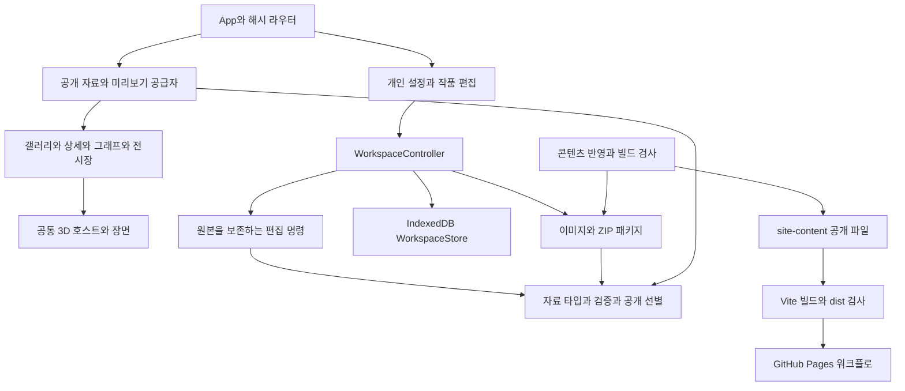

# 포트폴리오 플랫폼 구조 평가와 개선 순서

2026-10-10 기준으로 현재 실행 코드, 데이터 명세, 저장·패키지·배포 도구와 검증 기록을 평가했다. **각자 복제해 운영하는 정적 전시장에 적합한 기반이며, 공개 전에 저장 안전성과 화면 상태 복원을 보완해야 한다.** 기능 영역의 분리는 유지하고, 데이터 보존 → 화면 수명 → 브라우저 회귀 검사 → 코드 정리 순서로 개선하는 것이 적절하다.

기존 자동 검사 182개와 TypeScript·콘텐츠·루트 빌드·출력 검사는 이번 평가에서도 통과했다. 별도 재현 검사에서 저장 관련 문제 두 개를 확인했고, 실제 브라우저에서 2D·3D 그래프의 화면 왕복 문제를 확인했다. 아래 문제 설명은 최초 평가 당시의 재현 기록이다. 이후 우선 개선에서 P1 저장 문제와 P2 그래프 복원·브라우저 검사·이미지 한도를 수정했으며 반영 상태는 아래에 별도로 기록했다.

## 전체 구조

| 영역 | 담당 역할 | 평가 |
| --- | --- | --- |
| `src/domain`와 `spec/schemas` | 자료 계약, 참조 관계, 생성·조회·편집·공개 선별 | 핵심 규칙을 UI와 분리한 점이 좋다. 일부 타입 의존 방향은 정리할 수 있다. |
| `src/packages` | ZIP, manifest, 이미지 실물, 백업과 공개 패키지 | 브라우저와 빌드가 같은 파일 검증을 재사용한다. 파일 정책과 이미지 한도는 더 통일해야 한다. |
| `src/storage` | 편집 상태, 저장 큐, IndexedDB와 입력 원문 보관 | 한 탭의 저장·가져오기는 보호하지만 탭 간 충돌과 읽기 실패 복구가 부족하다. |
| `src/content` | 공개 파일 로딩과 초안 스냅샷 미리보기 | 편집과 관람을 분리하고 요청 취소·오류 복구를 제공한다. 배포 revision과 관람 캐시의 연결은 후속 개선점이다. |
| `src/features` | 화면과 사용자 조작 | 기능 경계는 명확하다. 큰 JSX와 상태 수명 코드가 압축돼 읽기 어렵다. |
| `src/three` | 렌더러, 프레임, 자원 해제, 두 종류의 장면 | 공통 호스트와 필요할 때 렌더링하는 방식이 좋다. 화면별 카메라 저장 방식은 통일해야 한다. |
| `scripts`와 `.github` | 공개 파일 반영·빌드·배포 | 자료와 앱 소스를 분리하고 dist만 배포하는 방향이 적절하다. 실제 GitHub 실행은 아직 확인 대상이다. |
| `tests`와 `spec/verification.md` | 자동 규칙 검사와 단계별 브라우저 검증 기록 | 단위·저장·패키지 검사가 충실하다. React 화면 왕복과 두 탭 편집을 자동으로 검증하는 계층이 필요하다. |

## 유지할 강점

공통 코드와 개인 자료가 분리되어 있다. 친구가 `site-content`만 교체해 이름·작품·이미지를 바꿀 수 있고, 브라우저 초안이나 전체 백업이 공개 빌드에 자동으로 들어가지 않는다. 공개 선별은 원본을 복제한 뒤 초안·미확인 그래프·미사용 이미지를 제외한다.

자료를 다루는 경계마다 검증한다. JSON 형식만 검사하는 데 그치지 않고 작품 ID, 순서, 노드 연결, 부모 순환과 이미지 참조를 확인한다. ZIP 경로·목록·크기·CRC32와 실제 이미지 디코딩을 확인하며 가져온 자료는 저장 성공 후에 적용한다. 예시 구조를 실제 구조와 구분하는 것도 포트폴리오의 신뢰도에 도움이 된다.

3D가 기본 관람을 대체하지 않는다. 갤러리·시스템 목록으로 관람할 수 있고 3D 실패 시 복귀 경로를 유지한다. 그래프와 전시장이 같은 호스트를 사용하며 이벤트·프레임·장면 자원을 해제한다. 첫 관람에 Three.js 전체를 불러오지 않고 편집기·3D를 나눠 읽는 점도 유지해야 한다.

현재의 독립 복제 방식에는 React·TypeScript·정적 파일과 GitHub Pages 구성이 맞는다. 서버 계정·공유 데이터베이스가 필요한 요구가 생기기 전까지 현재의 정적 운영 구조를 유지할 수 있다.

## 공개 전 수정할 문제

### P1 여러 탭에서 저장한 변경이 사라짐

위치: [WorkspaceStore](../src/storage/workspaces.ts), 특히 저장 트랜잭션의 75행. 저장 큐는 Store 인스턴스별이며 현재 검사는 기존 revision이 새 revision보다 큰 경우만 거부한다. 두 탭은 같은 revision에서 서로 다른 수정을 만들 수 있다. 서로 다른 workspaceId에 대한 교체도 일반 저장과 구분하지 않는다.

재현은 실제 사용자 저장소 대신 `fake-indexeddb`의 별도 메모리 DB에서 진행했다. 같은 저장본을 두 Controller/Store가 읽고 A는 이름, B는 전시장 제목을 바꿨다. A 저장 뒤 B 저장에서 두 탭 모두 성공과 미변경 상태를 표시했지만, 최종 저장본의 이름은 원래의 빈 값으로 돌아갔다. A의 변경이 B의 오래된 스냅샷에 의해 사라진 것이다.

개선은 읽었던 저장본의 식별자와 저장 버전을 일반 저장에 전달하고, 같은 트랜잭션 안에서 현재 저장본과 일치할 때만 기록하는 방식으로 한다. 이는 현재 편집 revision이 아니라 **편집을 시작한 저장본의 버전**을 비교해야 한다. 같은 revision을 단순히 거부하는 수정만으로는 두 탭의 편집 횟수가 다를 때 생기는 덮어쓰기를 해결하지 못한다.

가져오기의 의도적 교체는 별도 작업으로 구분하고, 저장본이 그 사이 바뀌었다면 다시 확인한다. 탭 간 변경 알림에는 BroadcastChannel 등을 사용할 수 있지만 알림 자체가 원자적인 저장 충돌 검사를 대신하지는 않는다. [Broadcast Channel API](https://developer.mozilla.org/en-US/docs/Web/API/Broadcast_Channel_API)

완료 기준: 두 탭의 동일 revision·서로 다른 revision·가져오기 후 오래된 탭 저장에서 변경이 조용히 사라지지 않는다. 충돌한 탭은 자기 미저장 내용을 유지하고 다시 읽기·백업·교체 선택을 제공한다.

### P1 저장본 읽기 실패 후 빈 초안이 기존 자료를 교체함

위치: [WorkspaceController](../src/storage/controller.ts)의 initialize 34행과 [WorkspaceStore](../src/storage/workspaces.ts)의 기존 이미지 교체 처리. 읽기에 실패해도 초기의 새 빈 session을 `ready: true`로 만들어 편집·저장 버튼을 사용할 수 있다. 그 빈 session은 새 workspaceId를 가지므로 앞의 저장 비교를 통과하고 기존 이미지까지 정리한다.

별도 메모리 DB에 작품 3개·이미지 3개를 정상 저장한 뒤, 로드 시 이미지 디코더가 일시적으로 실패하게 했다. Controller는 오류를 표시하면서 작품 0개의 빈 초안을 준비했다. 이어 저장을 실행하자 “저장했습니다”가 표시되고 기존 저장본은 작품 0개·이미지 0개로 바뀌었다. 실제 사용자 자료는 이 재현에 사용하지 않았다.

`초안 없음`과 `초안 읽기 실패`를 다른 상태로 다뤄야 한다. 읽기 실패 시 기존 키를 덮어쓰는 저장을 막고 다시 읽기·복구 파일 가져오기 또는 명시적인 새 작업 생성으로 진행한다. 초기화 Promise도 실패 후 다시 시도할 수 있어야 한다. 파일 백업으로 복구할 수 있도록 저장본의 원본 데이터와 파일을 가능한 범위에서 보존한다.

완료 기준: 이미지 디코딩·지원하지 않는 데이터 버전·저장소 읽기 실패 후에도 기존 저장본과 Blob이 남고, 사용자 확인 없는 빈 자료 교체가 발생하지 않는다.

### P2 화면 왕복 시 그래프 확대와 시점이 초기화됨

위치: [ArchitectureExplorer](../src/features/architecture/ArchitectureExplorer.tsx)의 16·20·31·32행. `onBox`와 `onCamera`는 최신 ref와 세션 저장소를 갱신한다. 그러나 종료 effect는 마지막 부모 렌더 시점의 `current.current`를 다시 저장한다. 자식의 확대·카메라 조작만으로 부모가 다시 렌더되지 않으면 최신 값을 오래된 값으로 덮어쓴다.

실제 브라우저의 기획 예시에서 다음을 확인했다. 2D viewBox가 `0 0 634 338`에서 확대 후 `79.25 42.25 475.5 253.5`로 바뀌었지만 상세 화면을 거쳐 같은 확대 그래프로 돌아오자 초기값으로 돌아갔다. 3D에서도 드래그로 바꾼 시점이 같은 왕복 뒤 기본 시점으로 돌아갔다. 선택이나 강조를 추가로 바꿔 부모를 다시 렌더시키면 드러나는 조건이 달라질 수 있다.

전시장에서는 종료 시 최신 `camera.current`를 합쳐 저장하는 처리가 이미 있다. 그래프에도 최신 camera/box를 직접 합쳐 저장하거나, 공통 상태 저장 함수를 두어 콜백·종료·화면 이동이 같은 스냅샷을 사용하게 한다. [React effect의 종료 동작](https://react.dev/reference/react/useEffect)

완료 기준: 2D 이동·확대와 3D 회전·확대 직후 상세↔확대 그래프를 왕복해도 같은 값을 복원한다. 노드 선택이나 강조 변경을 중간에 해야만 복원되는 조건을 제거한다.

## 구조와 검증 개선

| 우선순위 | 개선 | 현재 근거 | 실행 방향 |
| --- | --- | --- | --- |
| P2 | 브라우저 회귀 검사 | `npm test`는 Node 검사이며 현재 CI에 React 화면 왕복 검사가 없다. 실제로 182개 통과 상태에서 위 문제를 재현했다. | 별도 `e2e` 검사와 CI 작업에 탭 충돌, 읽기 실패 복구, 이미지 ZIP 왕복, 그래프 시점 복귀, 두 base 직접 접근을 추가한다. |
| P2 | 이미지 한도 통일 | 브라우저 `inspectImage`는 파일 크기와 양수 픽셀만 검사하지만 Node 디코더는 4천만 픽셀 제한이 있다. | 공통 이미지 정책에 픽셀 한도를 두고 등록 화면에서 미리 안내·거부하거나 축소를 제공한다. 이번에는 초대형 이미지를 브라우저에 실제 등록하는 재현은 하지 않았다. |
| P2 | 재사용 배포 확인 | 폴더에 `.git`가 없고 실제 저장소/Pages 주소가 아직 연결되지 않았다. | 실제 기본 브랜치의 검사·배포·주소, 다른 계정의 빈 템플릿 복제와 개인화까지 완료 기준으로 기록한다. |
| P3 | 편집 내용과 화면 상태의 revision 분리 | `rememberEditor`가 화면 이동만으로 revision을 올린다. 저장된 session에서 내보내기 화면으로 이동했을 때 내용은 같지만 dirty가 되는 것을 재현했다. | 콘텐츠 변경과 편집 화면 위치의 변경을 구분하고 저장 표시·내보내기 링크 무효화·이탈 경고에는 적절한 변경 버전을 사용한다. |
| P3 | Controller 책임 분리 | Controller 약 20.7천 문자에 필드 입력, 작품/사례/그래프/이미지 명령, 저장·가져오기·내보내기가 모여 있다. | 공개 API는 유지하면서 순수 편집 명령과 작업 상태·저장 조율을 분리한다. UI가 규칙을 중복하지 않게 한다. |
| P3 | 코드 형식과 화면 구성 정리 | StudioEditor의 한 줄은 최대 1,783자이며 3D·그래프 화면도 긴 한 줄에 여러 상태와 JSX가 들어간다. | 포맷터·린터를 도입하고 프로필·전시 설정·배포 안내, 그래프 toolbar/설명, 전시장 목록을 의미 있는 컴포넌트로 분리한다. |
| P3 | 의존 방향과 파일 정책 정리 | domain/edit가 packages의 PendingInput 타입에 의존하고 storage가 features/media의 정규화 함수를 가져온다. 파일 경로 정책도 ZIP·manifest·빌드에서 반복된다. | 데이터/편집 계약을 하위 공통 계층에 두고 YouTube 정규화와 플레이어를 분리한다. 허용 경로와 한도를 단일 정책 모듈로 관리한다. |
| P3 | 초기 로드와 큰 자료 성능 측정 | 초기 JS 약 459kB, 압축 약 141kB. 공통 3D chunk 약 519kB, 압축 약 129kB이며 크기 경고가 있다. 입력 때 전체 자료 복제·검증을 수행한다. | 번들 분석 후 Ajv 사전 생성 검증기 등을 검토하고 50·200노드의 입력·탐색 시간을 측정한다. 큰 ZIP의 동기 압축 해제도 worker 이전 대상으로 측정한다. |
| P3 | 공유용 정적 메타데이터 | 원본 index.html의 title은 공통 IO이며 description·Open Graph가 없다. 작품 주소는 hash를 사용한다. | 우선 공개 site 자료에서 제작자·전시장 제목/설명과 공유 이미지를 빌드 때 출력한다. 작품별 검색 유입이 필요해지면 정적 상세 URL을 별도로 검토한다. |

Playwright Test는 브라우저별 검사와 CI 실행을 제공하므로 후속 E2E의 후보로 적합하다. 현재 사용하는 CUA 수동 검증과, 저장소에 포함해 CI에서 반복 실행하는 검사는 별도다. [Playwright 공식 안내](https://playwright.dev/docs/intro)

성능 개선은 번들 경고의 숫자만 줄이는 작업으로 판단하지 않는다. 실제 내려받는 양과 초기 조작 준비 시간을 비교하고, 이미 적용된 편집기·3D 지연 로드는 유지한다. [Vite production build](https://vite.dev/guide/build.html)

검색과 공유는 구분한다. JavaScript로 title을 바꾸는 것만으로 모든 공유 서비스가 작품별 제목을 읽는다고 보장할 수 없다. Google 역시 페이지에 맞는 제목·설명과 실제 URL 링크를 다루도록 안내한다. [JavaScript SEO 기본](https://developers.google.com/search/docs/crawling-indexing/javascript/javascript-seo-basics)

## 개선 작업 순서와 완료 기준

1. **저장본 보존**: 읽기 실패 상태와 일반 저장/명시적 교체를 분리하고 저장본 버전 비교를 연결한다. 두 탭·복구 실패 재현이 회귀 검사에서 막히는지 확인한다.
2. **관람 상태 복원**: 그래프의 최신 camera/box 저장을 수정하고 화면 왕복을 브라우저 검사로 고정한다. 전시장도 같은 상태 저장 원칙을 따른다.
3. **실제 운영 검증**: 저장소와 Pages 주소를 연결하고 실제 프로젝트 콘텐츠와 친구의 독립 복제·배포를 확인한다.
4. **유지보수 정리**: 포맷터·린터·공통 정책과 Controller/화면 분리를 단계적으로 적용한다. 동작 보존을 검사하며 파일 수를 늘리는 것 자체를 목표로 삼지 않는다.
5. **포트폴리오 품질**: 대표 이미지·영상·기여·개발 사례를 채우고 공유 메타데이터와 실제 기기 성능을 개선한다.

## 평가의 확인 범위

이번 평가의 저장 재현은 실제 Store/Controller와 독립된 fake-indexeddb로 수행했다. 브라우저 검증은 별도 탭의 기획 예시 미리보기만 사용했으며 실제 편집 초안을 저장하거나 바꾸지 않았다. 그래프 왕복 시점의 화면 기록은 `/private/tmp/io-review-graph-rotated.png`와 `/private/tmp/io-review-graph-returned.png`에 있다.

182개 자동 검사의 재실행은 현재 검사 범위가 통과한다는 뜻이다. 새로 발견한 문제의 수정 완료, 실제 프로젝트 영상·구조의 정확성, 실제 GitHub 배포 성공이나 모든 기기의 GPU 성능을 뜻하지 않는다. 개선 구현은 위 순서와 완료 기준으로 별도 진행한다.

## 우선 개선 반영 상태

2026-10-10 우선 개선으로 아래 항목을 반영했다. 기존 평가의 문제 재현은 역사 기록이며 현재의 미수정 상태를 뜻하지 않는다.

| 항목 | 상태 | 확인 |
| --- | --- | --- |
| 탭 간 저장 덮어쓰기 | 수정 | 같은/다른 편집 횟수, 새 탭 첫 저장, 가져오기 뒤 오래된 탭, 확인 중 변경을 차단 |
| 읽기 실패 뒤 빈 저장본 교체 | 수정 | 최초 읽기 실패 저장 차단, 다시 읽기, 메모리 보존과 확인한 파일 복구 |
| 그래프 2D·3D 왕복 초기화 | 수정 | 브라우저에서 viewBox·실제 카메라 수치 복원 검사 |
| 브라우저 회귀 검사 | 추가 | Chromium 7개를 로컬에서 통과, Pages 배포 전에 실행하도록 연결 |
| 이미지 한도 불일치 | 수정 | 공통 4천만 픽셀 정책과 등록 안내 |
| 화면 이동만으로 dirty 표시 | 수정 | 콘텐츠 revision은 유지하고 화면 위치만 갱신 |

현재 자동 검사 195개와 브라우저 검사 7개를 통과했다. 실제 GitHub 배포·다른 계정 복제는 저장소 URL 연결 후 확인해야 한다. 이후의 코드/Controller 분리, 포맷터·린터, 파일 정책 정리, 성능 분석과 공유 메타데이터는 다음 개선 범위로 남는다.

## 구조 정리 반영 상태

2026-10-10 Controller의 편집 규칙을 edit-commands로 옮기고 프로필·전시 설정·작품 목록·배포 안내·사례 편집 화면을 분리했다. PendingInput과 영상 정규화의 의존 방향 및 공통 패키지 정책도 정리했다. 기존 Controller는 문자 수 기준 약 23.8천에서 13.7천으로 줄었으며 전체 코드 크기나 실행 성능이 그 비율로 줄었다는 뜻은 아니다.

코드 형식 검사와 기본 correctness·Hook·계층 가져오기 린트를 추가하고 CI 조건으로 연결했다. 원본 불변 편집 명령 2개 검사와 설정 화면 왕복 1개 검사를 추가하여 **Node 197개·Chromium 8개**를 통과했다. 저장 충돌·읽기 복구·그래프 시점·이미지 ZIP 보호는 그대로 확인했다.

이로써 Controller/설정 화면 분리, 형식·린트 도입과 기본 의존·파일 정책 정리를 반영했다. 남은 개선은 실제 저장소/친구 계정 배포 확인, 번들·큰 자료 성능 분석과 공유 메타데이터다. React Compiler 전용 진단은 기술 기록에 명시한 범위로 별도 적용 대상이며, 이번 린트 통과가 모든 스타일·접근성·성능 기준 통과를 뜻하지 않는다.

## 초기 로딩과 공유 개선 반영

2026-10-10 초기 JS의 정적 import 포함 합계는 458,902에서 391,229 bytes, 동일 gzip 합계는 139,847에서 94,498 bytes로 감소했다. 상세/전시장 화면과 ZIP 처리 분리 및 매 빌드 Schema 사전 생성 검증을 적용했다. 초기 전체 JS 예산을 빌드에 연결하고 실제 프로덕션 요청의 지연 경계를 검사한다. 큰 3D chunk 경고는 유지하며 실제 모바일 GPU·큰 그래프/ZIP의 성능까지 해결했다는 의미는 아니다.

공개 설정/작품의 정적 Open Graph와 JPEG 카드, 작품별 share/<slug>/ HTML, Pages base_url과 공개 링크 복사를 연결했다. Node 202개·브라우저 13개, 두 base 빌드와 형식/린트/타입 및 dist/예산 검사를 통과했다. JavaScript 없는 메타데이터와 공유 주소→상세·재로드, 복사 권한 허용/거부 및 지연 chunk 실패 복귀도 확인했다.

다음은 실제 GitHub 저장소·다른 계정의 독립 배포와 실제 메신저 카드 확인, 실제 프로젝트 자료 반영이다. 후속 성능 측정은 50/200노드와 큰 ZIP·이미지 및 실제 기기로 범위를 넓힌다. [기술 기록](./technical-plan.md)과 [공유/배포 안내](./github-pages-guide.md)에 상세 조건을 남겼다.

## 큰 자료 성능 개선 반영

2026-10-10 50/200노드와 이미지/약 24MiB ZIP을 별도 프로덕션 harness에서 측정했다. 200노드 편집 폼의 닫힌 선택 항목 285400개 생성이 약 399ms를 사용해 펼칠 때 폼을 만들도록 바꿨다. 초기 생성은 약 3ms이며 접힘/열림 후 값·오류 원문이 유지된다. 2D 이동 도형 재사용, 3D label atlas/관계선·화살표 묶기, 이미지 Blob 검증 재사용과 큰 ZIP Worker 및 압축/재검사 조율을 적용했다.

라벨 RGBA 1레벨 픽셀 추정은 약 304→52MiB, 실제 renderer textures는 810→13, calls는 2420→1033이다. 구성/반응성·자원 비용의 개선이며 200노드의 첫 render 호출과 ZIP의 전체 완료 시간은 오히려 증가했다. 실제 기기 FPS 향상을 주장하지 않는다. 시간 대신 자원 상한/정리·조작·CRC·Worker 오류/초안 보존을 CI에서 검사한다. Node 209개/Chromium 18개와 두 base 빌드·형식/린트/타입·dist/초기 번들 예산을 통과했다.

다음은 실제 모바일/다른 브라우저 GPU와 상한 근처 자료의 측정, 실제 프로젝트 콘텐츠와 공개 배포 검증이다. 구현과 원시 수치는 [기술 기록](./technical-plan.md)과 [측정 자료](../spec/performance/2026-10-10-large.json)에 남겼다.
