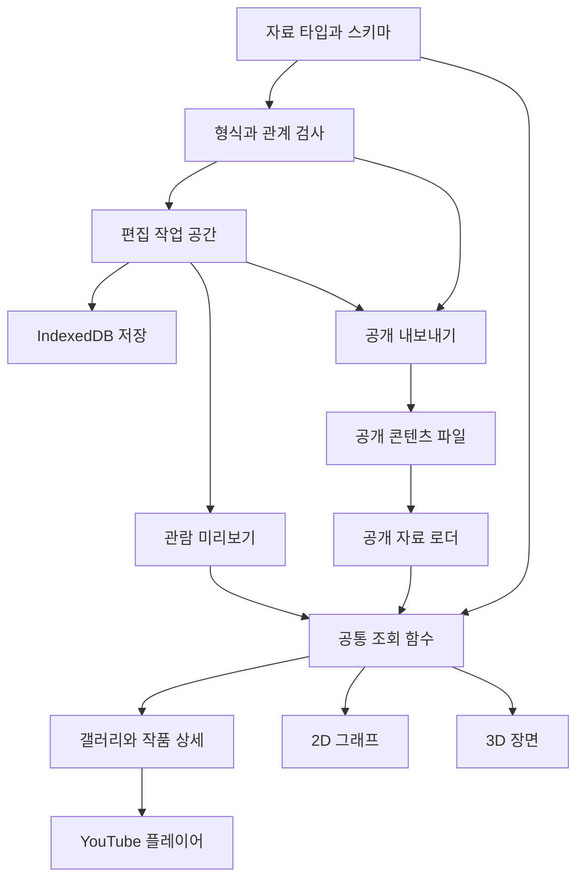

# 포트폴리오 전시장 공통 기능 기술 설계

각자 복제해 자기 GitHub Pages에서 운영하는 전시장 플랫폼의 모듈과 연결 방식을 정의한다. 같은 작품 데이터를 관람 화면과 편집 도구에서 사용하며, 저장과 공개 내보내기는 화면 및 3D 렌더링과 분리한다.

이 문서는 구현 기준이다. React·TypeScript·Vite 환경, 자료 타입과 생성, Ajv 및 관계 검증, 공개 선별과 기본 해시 라우팅을 구현했다. IndexedDB 저장과 파일 패키지, 이미지 검사와 가져오기 확인도 구현했다. 관람·작품별 편집·3D와 템플릿 콘텐츠 반영 및 Pages 워크플로도 구현했다. 실제 저장소 배포와 프로젝트 콘텐츠 검증은 후속 확인 대상이다. 초기 갤러리는 legacy/static-gallery에 보존했다. 기능과 자료 형식은 [플랫폼 기획](./portfolio-plan.md), [화면 기획](./wireframe-plan.md), [데이터 명세](./data-contract.md)를 따른다.

## 기술 구성

| 영역 | 선택 방향 | 적용 목적 |
| --- | --- | --- |
| 화면과 편집기 | React와 TypeScript | 공통 UI, 명시적인 자료 타입과 상태 연결 |
| 개발과 정적 빌드 | Vite | 개발 서버, 모듈 분리와 dist 출력 |
| 화면 주소 | 해시 라우팅 | GitHub Pages에서 상세 주소 직접 접근 |
| 데이터 형식 검사 | Ajv의 Draft 2020-12 구현과 ajv-formats | 기존 JSON Schema와 날짜 및 URI 검사 |
| 관계 검사 | 순수 TypeScript 함수 | R01부터 R15까지의 ID 및 참조 규칙 |
| 2D 그래프 | SVG와 일반 웹 설명 패널 | 노드 선택과 구조 읽기 |
| 3D 전시장과 그래프 | Three.js | 공간, 시점, 선택과 자원 관리 |
| 초안과 이미지 저장 | IndexedDB | JSON 자료, 입력 상태와 이미지 Blob 저장 |
| 가져오기와 내보내기 | ZIP 처리 모듈 | 자료와 이미지 파일 묶음 이동 |
| 공개 배포 | GitHub Actions와 GitHub Pages | 검증한 dist만 배포 |

React는 UI를 컴포넌트로 나누고 자료와 상태를 연결하는 구성을 제공한다. 이 프로젝트에서는 프로필과 작품 편집 화면의 반복 구성을 재사용하기 위해 선택한다. [React의 UI와 상태 구성](https://react.dev/learn/thinking-in-react)

Vite의 정적 배포 흐름은 빌드 결과를 dist에 생성하고 GitHub Pages 경로에 맞는 base를 설정한다. 사용자 사이트와 저장소 하위 사이트에 맞게 배포 설정을 계산한다. [Vite 정적 배포 안내](https://vite.dev/guide/static-deploy.html)

첫 구현에서 React 19.3.0, TypeScript 7.0.2, Vite 8.3.3, React 플러그인 6.1.2, Ajv 8.20.0과 ajv-formats 3.0.1을 Node 22.23.2에서 확인하고 package-lock.json에 고정했다. ZIP 처리에는 fflate 0.8.3을 사용한다. 압축 생성 후 다시 읽어 manifest, 파일 목록과 CRC32 및 이미지 실물을 확인한다. [fflate 공식 저장소](https://github.com/101arrowz/fflate) 프레임워크를 바꾸어도 자료 형식과 순수 검증 함수는 유지한다.

## 모듈 관계



관람 화면은 공개 자료 또는 편집 미리보기 자료를 읽는다. 화면에서 직접 파일 저장이나 공개 내보내기를 실행하지 않는다. 그래프와 3D 모듈도 작품 공개 여부를 별도로 판단하지 않고 공통 조회 함수의 결과를 사용한다.

## 디렉터리 구성 제안

```text
src/
  app/               앱 시작, 라우터와 오류 화면
  domain/            자료 타입, 생성, 검증과 공통 조회
  content/           공개 자료 로딩과 버전 확인
  state/             관람 및 편집 상태
  features/
    gallery/         목록과 소개
    project/         작품 상세
    architecture/    공통 그래프 선택과 설명
    exhibition/      전시장 화면과 방 배치
    studio/          개인 설정과 작품 편집
  renderers/
    graph2d/         SVG 배치와 선택
    three/           렌더러, 장면과 3D 자원
  media/             YouTube와 이미지 표시
  storage/           초안 및 Blob 저장
  packages/          자료 가져오기와 내보내기
  ui/                공통 버튼, 필드, 안내와 테마
scripts/
  verify-content/    공개 자료 검사
  prepare-content/   공개 파일 생성과 복사
  build/             dist 생성 순서
public/
  content/           공개 대상으로 정리한 자료만 보관
  assets/            공개 자료가 참조하는 이미지
spec/                자료 스키마, 예시와 검증 기록
docs/                기획과 사용 안내
```

작성용 전체 초안은 public 디렉터리에 넣지 않는다. 개인이 저장소에서 관리하는 자료도 공개 가능한 콘텐츠만 커밋하도록 안내한다. 비공개 초안과 브라우저 백업은 사용자의 별도 보관 자료다.

## 자료와 상태의 책임

| 상태 | 내용 | 보관 방식 |
| --- | --- | --- |
| 공개 자료 | 공개 프로필, 작품, 그래프와 자산 목록 | 사이트 정적 파일 |
| 작업 자료 | 편집 중인 workspace와 자산 Blob | 메모리와 IndexedDB |
| 입력 상태 | 아직 형식에 맞지 않는 원문과 필드 오류 | 편집 상태와 초안 백업 |
| 관람 상태 | 주소, 출발 화면, 스크롤, 작품과 노드 선택 | 세션 메모리와 탐색 기록 |
| 3D 시점 | 전시실, 카메라와 그래프 카메라 | 세션 메모리 |
| 작업 결과 | 저장 중, 저장 완료, 내보내기 실패 등 | 개별 작업 상태 |

작업 자료와 공개 자료를 같은 객체에 연결해 편집이 즉시 공개된 것처럼 보이게 하지 않는다. 미리보기는 작업 자료의 읽기 전용 스냅샷을 사용한다. 공개 대상 보기에서는 published 작품을, 편집용 전체 보기에서는 초안을 포함하는 모드를 명시한다.

입력 원문은 안정적인 작품 및 시스템 ID와 필드 경로로 연결한다. 배열 순서를 바꿔도 입력 대상이 유지되어야 한다. 잘못된 URL 원문은 보존하지만 기존의 유효한 영상 ID를 임의로 대체하지 않는다.

## 데이터 계층의 공통 함수

아래는 구현 시 제공할 계약이다. 함수 이름은 내부 이름이며 제품 화면에는 표시하지 않는다.

| 함수 | 입력과 결과 | 책임 |
| --- | --- | --- |
| createWorkspace | 빈 workspace | 친구가 시작하는 기본 자료 |
| createProject | 새 작품 초안 | 고유 ID와 slug 생성 |
| validateStructure | unknown 자료에서 형식 오류 목록 | 버전, 타입과 필수 키 검사 |
| validateRelations | workspace와 오류 목록 | R01부터 R14의 관계 검사 |
| validateAssets | 자료, 자산 파일과 오류 목록 | 참조 및 실제 이미지 검사 |
| selectProjects | 자료, 관람 모드에서 작품 목록 | 공개 여부와 순서의 공통 적용 |
| selectProject | 작품 ID 또는 slug에서 작품 | 상세와 공간의 같은 자료 조회 |
| selectArchitecture | 작품 ID에서 그래프 또는 없음 | 관람 모드에 맞는 구조 선택 |
| preparePublicContent | workspace에서 public 자료와 안내 | 원본을 보존하고 공개 대상 정리 |
| validatePublicContent | public 자료에서 오류 목록 | 공개 필수값과 R15 검사 |

형식 검증기는 값을 자동 변경하지 않는다. 타입 강제 변환, 기본값 삽입과 알 수 없는 키의 자동 제거를 끈다. 기본값은 자료 생성 함수에서 넣고 입력 정리는 별도의 명시적인 처리로 둔다.

Ajv는 Draft 2020-12에 맞는 클래스를 사용해야 하며, 날짜와 URI 형식 검사는 ajv-formats를 명시적으로 연결한다. 기존 Python 검사 결과에 더해 브라우저에서 사용할 검증기의 컴파일과 동일 예시 판정을 첫 구현 단계에서 확인한다. [Ajv 스키마 버전 안내](https://ajv.js.org/json-schema.html), [Ajv 형식 검사](https://ajv.js.org/guide/formats.html)

화면용 오류는 code, severity, path, message와 대상 ID로 구성한다. 내보내기 오류는 어느 작품이나 시스템을 수정해야 하는지 알려주는 이동 대상을 포함한다. 검증 함수를 실행할 때 원본 자료의 값이나 배열 순서를 바꾸지 않는다.

## 공개 자료 로더

앱 시작 시 site.json, projects.json과 자산 목록을 읽는다. 그래프 파일은 해당 작품의 상세를 열 때 읽고, 3D 자원은 해당 모드에 들어갈 때 읽는다. 같은 배포 안에서 자료를 읽으므로 별도 API 서버는 두지 않는다.

로더는 정상 자료, 콘텐츠 없음, 버전 불일치, 네트워크 실패와 잘못된 파일을 구분한다. 공개 대상이 0개인 상태는 정상 빈 전시장이다. 파일 오류가 있을 때 기획 예시나 다른 사람의 자료로 대체하지 않는다.

공개 콘텐츠와 앱 버전의 캐시 혼합을 줄이기 위해 배포 시 manifest에 자료 버전과 출력 식별자를 기록한다. 첫 버전은 서비스 워커를 사용하지 않는다. 잘못된 캐시가 의심되는 경우 다시 불러오기 경로를 제공한다.

미리보기 자료 공급자는 파일 로더를 호출하지 않고 현재 작업 스냅샷을 같은 조회 인터페이스에 제공한다. 미디어 경로는 공개 공급자에서는 base 아래 정적 URL, 작업 공급자에서는 Blob URL로 해석한다.

## 라우팅과 복귀

| 주소 | 화면 |
| --- | --- |
| #/gallery | 갤러리 |
| #/exhibition | 전시장 |
| #/projects/slug | 작품 상세 |
| #/projects/slug/architecture | 그래프 확대 보기 |
| #/studio/profile | 기본 정보 |
| #/studio/projects | 작품 목록 |
| #/studio/projects/id | 작품 편집 |
| #/studio/presentation | 전시 설정 |
| #/studio/export | 내보내기 |

기존 기획의 #/studio는 설정 진입 별칭으로 유지한다. 주소의 slug와 작업 자료의 id를 구분한다. 존재하지 않는 작품 주소는 찾을 수 없음 화면으로 연결한다.

관람 화면에서 상세를 열면 origin, 작품 ID, 목록 스크롤 또는 전시실 및 시점을 탐색 기록에 넣는다. 그래프 확대 보기에서 돌아오면 상세의 아키텍처 영역으로 복귀한다. 주소를 직접 연 경우 기본 복귀 대상은 갤러리다.

설정의 미리보기는 작업 공간 참조를 메모리에 유지하고, 미리보기 상단에 설정으로 돌아가기를 표시한다. 관람객에게 보여주는 공개 내비게이션에는 설정 버튼을 넣지 않는다. 미리보기 표시는 별도의 편집 세션 UI다.

라우트 전환으로 취소된 로딩 결과가 나중에 도착해 새 화면을 덮어쓰지 않도록 요청 ID와 취소 신호를 관리한다. 카메라와 스크롤은 데이터 내보내기의 공개 필드로 저장하지 않는다.

## 3D 렌더링과 자원

앱은 활성 WebGL 렌더러를 최대 하나로 관리한다. 전시장과 3D 그래프는 같은 렌더링 호스트에 각각의 장면과 카메라를 연결한다. 갤러리와 2D 그래프에서는 렌더러를 처음부터 생성하지 않는다.

| 구성 | 책임 |
| --- | --- |
| RendererHost | canvas, 크기, 픽셀 비율과 활성 루프 |
| ExhibitionScene | 전시실과 작품 패널, 이동 지점 |
| ArchitectureScene | 시스템과 연결선, 층별 배치 |
| SceneSession | 작품 선택과 카메라 복원 정보 |
| ResourcePool | 공유 이미지와 모델의 수명 |
| Picking | 선택한 물체를 안정적인 작품 및 노드 ID로 변환 |

전시실 배치는 공개 작품 순서를 입력으로 계산한다. 방당 최대 여섯 작품이라는 기획 규칙을 사용하고 작품 수가 바뀌면 자동으로 방을 구성한다. 첫 구현은 단순한 전시 패널과 공간으로 동작을 완성하고, 실제 게임 자료에 기반한 미술 자산은 이후 결합한다.

3D 오브젝트 선택은 자료 변경이 아니라 작품 또는 노드 선택 이벤트를 전달한다. React 화면은 일반 버튼과 목록에서도 같은 이벤트를 발생시킨다. 3D 텍스트에 긴 기술 설명을 넣지 않고 웹 설명 패널을 사용한다.

장면을 바꾸면 기존 입력 이벤트와 애니메이션을 해제하고, 공유 사용이 끝난 geometry, material과 texture를 각각 정리한다. material 정리만으로 texture가 정리되는 것은 아니므로 자원별 수명을 관리한다. [Three.js 자원 정리 안내](https://threejs.org/manual/pages/how-to-dispose-of-objects.html)

작품 상세가 열린 동안 렌더링과 이동 입력을 중지한다. 브라우저가 비활성일 때 루프를 중지하고 돌아오면 화면 크기와 상태를 다시 확인한다. WebGL 초기화 실패나 context 손실 시 갤러리 또는 2D 보기를 제공한다.

## 그래프 배치와 선택

그래프 상태는 selectedNodeId, 강조 여부와 현재 보기로 관리한다. 두 렌더러가 같은 상태를 구독하고 화면 설명도 같은 노드 조회 결과를 표시한다.

2D는 그룹과 부모 관계를 기준으로 일정한 방향으로 배치하고, 그룹에 속하지 않은 노드는 별도 기본 영역에 둔다. 연결선의 source와 target 방향 및 라벨은 데이터 명세를 따른다. 노드의 배치 순서는 안정적인 규칙을 사용해 화면을 다시 열어도 예측 가능하게 한다.

3D는 그룹의 layer와 그룹 내 배치를 사용한다. 카메라가 돌아가도 노드와 관계의 뜻은 같아야 한다. 노드 라벨이 겹치면 전체 라벨을 작게 줄이기보다 선택 노드와 주변 노드 중심으로 보여주고 시스템 목록을 유지한다.

부모 관계 순환과 일반 연결선 순환을 구분한다. 모든 관계를 일방향 트리로 강제하지 않는다. 선택한 노드가 삭제되면 선택을 비우고 없는 노드를 계속 강조하지 않는다.

## YouTube와 이미지

YouTube 모듈은 플레이어 초기화, 준비, 재생 실패와 파괴를 관리한다. 재생 선택 전에는 포스터와 일반 버튼을 제공하고 API 스크립트는 첫 사용 시 로드한다. API 로딩 중 반복 선택으로 여러 플레이어를 만들지 않는다.

작품 이동, 그래프 확대 또는 설정 미리보기 종료 시 재생을 중지한다. 상세를 완전히 떠나면 플레이어와 이벤트를 정리한다. 영상 ID 유효성 검사와 실제 재생 가능 여부는 별개이며, 실패하면 다른 상세 콘텐츠를 유지하고 원본 링크를 제공한다.

이미지 모듈은 자산 ID를 자료 공급자의 URL로 변환한다. 작업 공간의 Blob URL은 사용이 끝나면 해제한다. 실제 이미지가 실패하면 작품명 표지를 표시하고 자산 오류를 편집 화면에 연결한다.

## 초안 저장 설계

IndexedDB는 구조화된 자료와 파일 및 Blob을 저장할 수 있는 브라우저 API다. 자료와 자산을 함께 관리하기 위해 선택한다. [IndexedDB 안내](https://developer.mozilla.org/en-US/docs/Web/API/IndexedDB_API)

| 저장소 | 키 | 값 |
| --- | --- | --- |
| workspaces | siteKey | workspaceId, 자료, 입력 상태와 저장 정보 |
| assets | workspaceId와 assetId | Blob과 자산 메타데이터 |

siteKey는 현재 origin과 정규화한 배포 base 경로로 만든다. 같은 GitHub 계정의 다른 저장소 사이트가 같은 origin을 사용해도 초안이 섞이지 않게 한다. 개인 표시 이름을 저장소 키로 쓰지 않는다.

저장 시 새 스냅샷과 자산을 같은 transaction으로 반영한다. 저장 성공은 개별 put 요청이 아니라 transaction 완료 이후에 표시한다. 실패하거나 중단되면 이전 저장본이 남아 있어야 한다. [IndexedDB transaction 안내](https://developer.mozilla.org/en-US/docs/Web/API/IDBTransaction)

저장 도중 사용자가 다시 편집한 경우, 완료 표시에는 저장한 revision을 기록한다. 현재 revision이 더 크면 변경 사항이 남아 있다고 표시한다. 저장을 중복 요청하면 직렬화하며 동시에 서로 다른 스냅샷을 덮어쓰지 않는다.

## 패키지 가져오기와 내보내기

가져오기, 전체 백업과 공개 콘텐츠 내보내기는 packages 모듈에서 관리한다. 공개 정리는 domain의 preparePublicContent를 사용하고 ZIP 처리는 파일 생성만 담당한다.

가져온 패키지는 임시 자료와 임시 자산으로 검증한다. 잘못된 경로, 파일 중복, manifest 불일치와 누락 자산을 확인한다. 경로는 데이터 명세가 허용한 범위로 제한하고 임의의 경로에 파일을 풀지 않는다. 검사 결과를 미리 보여준 뒤 사용자 확인으로 현재 작업 공간을 교체한다.

전체 백업은 workspace, pendingInputs와 자산을 보존한다. 공개 내보내기는 published 작품, verified 그래프와 참조 자산만 포함한다. 공개 사례의 필수값과 R15의 도달 가능한 자산 규칙을 마지막에 다시 검사한다.

내보내기 파일에는 콘텐츠만 넣으며 실행 코드나 다른 사용자의 초안이 포함되지 않는다. 실패하면 원본 자료와 공개 대상 선택이 유지된다. 다운로드 완료와 실제 배포 완료를 별도 상태로 표시한다.

## 빌드와 배포

빌드는 공개 콘텐츠 검증, 배포 자산 준비와 Vite 빌드 순서로 구성한다. 공개 콘텐츠는 site-content에 별도로 관리하고 public은 기본 아이콘·라이선스만 둔다. dist 안의 파일과 참조를 마지막으로 검사한다. docs, spec, 작성용 백업과 개인 초안은 사이트 출력에 복사하지 않는다.

GitHub Actions는 의존성 설치, 자료 검사, 필요한 테스트, 빌드와 Pages 배포를 수행한다. 정확한 action 버전과 Node 버전은 워크플로 구현 때 공식 안내와 호환성을 확인해 고정한다. Pages Source 설정은 사용자가 자기 저장소에서 선택해야 한다. [Vite의 GitHub Pages 배포](https://vite.dev/guide/static-deploy.html)

사용자 사이트는 base를 루트로, 프로젝트 사이트는 저장소 하위 경로로 설정한다. 배포 설정에서 base를 계산하며 프로필 이름이나 콘텐츠를 경로 계산에 사용하지 않는다. 모든 정적 파일 로더가 이 base를 사용한다.

템플릿 복제 시 첫 콘텐츠는 빈 전시장이다. 별도로 제공하는 첫 개인 전시장 초안과 기획 예시는 자동 공개하지 않는다. 설정 도구는 공개 사이트에서도 로컬 작업 공간으로 동작하지만 GitHub 저장소를 직접 수정하지 않는다.

## 현재 초안의 전환

초기 index.html, app.js, projects.js와 스타일 및 정적 자산을 legacy/static-gallery에 보존했다. 루트 index.html은 새 React 앱의 시작 파일이며 기존 정적 초안은 별도로 실행할 수 있다.

초안의 작품 ID와 제안 데이터의 ID는 다르므로 묵시적으로 기존 자료를 가져오지 않는다. 첫 개인 자료는 spec/examples/first-owner.workspace.json의 확인된 정보에서 시작한다. 현재 제목과 역할 외에 엔진과 성과 등을 자동 추정하지 않는다.

Three.js는 준비 자원과 같은 r180의 npm 패키지 0.180.0과 @types/three 0.180.0으로 통일했다. 기존 vendor 파일은 보존한 준비용 파일이며 실제 앱에서는 불러오지 않는다. 사용하지 않는 자원을 빌드 출력에 복사하지 않는다.

## 검증 전략과 완료 기준

핵심 검증은 입력을 바꾸었을 때 실제 결과가 달라지는 데이터 규칙과 상태 복원에 집중한다. 함수 구현을 그대로 따라 쓰는 테스트를 늘리지 않는다.

| 영역 | 주요 검증 |
| --- | --- |
| 데이터 | 중복 ID, 잘못된 참조, 부모 순환과 일반 순환의 구분 |
| 공개 정리 | 초안 제외, 그래프 확인, 참조 자산 보존과 원본 불변 |
| 패키지 | 내보내기 후 재가져오기의 자료 및 이미지 보존 |
| 저장 | transaction 실패 복구와 저장 중 편집 상태 |
| 탐색 | 상세 직접 접근, 갤러리와 3D 출발점 복귀 |
| 렌더링 | 2D와 3D의 같은 노드 선택 및 반복 전환 자원 관리 |
| 배포 | 루트와 저장소 하위 base에서 파일과 내부 주소 동작 |
| 재사용 | 다른 프로필과 0개, 1개, 3개 및 10개 작품 구성 |

과거의 Python 스키마 검사 통과는 브라우저 저장, Three.js 자원 관리와 실제 배포의 통과를 뜻하지 않는다. 해당 결과는 각 구현 단계에서 확인하고 기록한다.

## 구현 시작점

자료 타입, Ajv 연결, 관계 검사와 공개 정리 함수 구현을 완료했다. IndexedDB 저장과 파일 패키지도 구현했다. 공개 파일과 작업 스냅샷 공급자, 갤러리·작품 상세와 YouTube 주소 정리 및 수명 관리를 구현했다. 개인 정보·작품·사례·이미지·구조 목록과 전시 설정 편집도 연결했다. 2D·3D 아키텍처 관람 보기와 공통 호스트도 연결했다. 3D 전시장도 같은 호스트에 연결했다. 템플릿 빌드와 배포 안내도 연결했다. 다음은 실제 저장소와 작품 콘텐츠 검증이다. 구체적인 작업 순서와 완료 기준은 [구현 작업 계획](./implementation-plan.md)을 따른다.

## 갤러리·상세 구현 확인 — 2026-10-07

공개 로더는 manifest를 먼저 읽고 필수 JSON의 버전·바이트 수·구조·참조를 검사한다. 그래프는 상세에서 읽고 오류가 나도 다른 상세 콘텐츠를 유지한다. fetch는 no-store와 취소 신호를 사용한다. byteSize는 동일 크기 파일의 동일성을 보장하는 해시가 아니며, 이 단계에서 배포 캐시의 완전한 원자성을 주장하지 않는다. 이미지 실물 검사는 가져오기·저장·내보내기에서 수행하고 공개 관람 중에는 이미지 실패를 대체 표지로 표시한다.

미리보기는 공유 작업 controller의 독립 스냅샷이며 public/workspace 조회 모드를 명시한다. 종료와 교체 시 Blob URL을 해제한다. 현재 미리보기는 유효 자료만 표시하고 미정리 입력 원문은 편집 화면과 공개 내보내기 오류로 남긴다. 새로고침 후 미리보기 복원은 지원하지 않는다.

YouTube API는 첫 재생 선택에 한 번 로드하고 중복 초기화를 공유한다. API와 플레이어 준비 지연에는 오류·재시도 및 원본 링크를 제공한다. 준비 전 이탈하면 뒤늦은 플레이어 생성을 막고, 생성된 플레이어는 React의 DOM 제거 전에 파괴한다. 준비된 플레이어는 먼저 stopVideo를 호출한다. [YouTube IFrame API](https://developers.google.com/youtube/iframe_api_reference), [플레이어 매개변수](https://developers.google.com/youtube/player_parameters)


## 편집기 구현 확인 — 2026-10-07

공통 필드 변환은 문자열·선택 값·정수·줄별 항목·라벨/HTTPS 링크를 입력 형식에서 표준 자료로 변환하고 기존 검증기를 통과한 값만 반영한다. 대상 조회는 기존 own property만 허용하며 ID와 prototype 경로는 수정하지 못한다. 원문은 표준 값과 따로 보관하고 선택·추가·삭제는 자료 관계를 검증한 뒤 반영한다. 사례 배열 경로 정리와 새 사례에 과거 원문이 붙지 않는 처리를 검사했다.

workspace controller를 공유해 설정 단계와 미리보기 복귀 시 메모리 초안을 유지한다. 이미지 Blob URL은 편집 이미지 컴포넌트 해제 시 정리한다. 등록 전 이미지 설명은 페이지 수명의 작업 메모리에만 남기며 작품/작업 공간/이미지 종류로 구분한다. 직전 삭제 스냅샷은 콘텐츠 편집 후 폐기한다.

개발 모듈 교체 중 controller가 초기화되는 문제를 재현해 runtime의 HMR 경계를 추가했다. 기존 저장 큐와 미저장 상태를 유지하고 unload 경고 핸들러는 갱신 시 정리한다. 실제 새로고침은 IndexedDB 저장본을 복원한다. 배포 앱에는 HMR 기능이 포함되지 않는다.


## 2D·3D 그래프 구현 확인 — 2026-10-07

공통 모델은 layer와 ID로 그룹을 정렬하고 같은 그룹의 부모 깊이에 따라 배치한다. 일반 연결은 순환을 허용하고 방향·종류·라벨을 유지한다. 자기/평행 연결과 라벨 범위도 2D 전체 맞춤에 포함한다. 긴 라벨은 줄여 표시하고 전체 이름과 설명을 별도 시스템 목록·설명 패널로 제공한다. 3D 라벨은 SRGB CanvasTexture로 표시하며 선택 노드와 주변 노드 중심으로 표시한다.

RendererHost의 단일 소유권은 기존 세션을 정리한 뒤 새 세션을 시작한다. 2D에서는 renderer를 생성하지 않는다. 현재 그래프는 카메라/선택/크기 변경 시 한 프레임을 요청하고 중복 요청을 병합한다. 상시 animation loop는 없다. hidden 문서에서는 요청을 취소하고 복귀하면 다시 그린다. 해제 시 ResizeObserver, 이벤트, OrbitControls, 장면 geometry/material/texture, renderer와 컨텍스트를 정리한다. 호스트 API를 다음 전시장 구현에서 공유할 수 있으며 종료된 컨텍스트를 계속 유지하는 방식은 아니다. [Three.js 자원 정리](https://threejs.org/manual/pages/how-to-dispose-of-objects.html)

카메라 맞춤은 장면 경계 모서리를 현재 화면 비율과 시야각에 맞춰 계산한다. 카메라와 확대는 모드별로 유지하고 선택은 같은 출처/작품 ID에서 공유한다. 3D 초기화·장면 구성·그리기 실패와 context 손실 시 시스템 목록을 유지한 2D로 복귀한다. 개발용 context 손실 버튼과 기획 예시 미리보기는 production에서 제외한다.

최신 루트 빌드의 초기 JS는 약 450kB(압축 139kB), 선택 후 로드하는 3D chunk는 약 524kB(압축 132kB)다. Vite의 500kB chunk 경고가 남지만 3D는 이미 지연 로드하며 경고 한도를 바꾸어 숨기지 않았다. 모든 브라우저/기기 성능을 보장하는 수치는 아니다. 다음 전시장 단계에서 공통 3D chunk를 재사용하고 필요한 경우 크기를 추가로 줄인다. license는 public/licenses/three.txt로 빌드에 포함한다.


## 전시장 구현 확인 — 2026-10-10

자동 배치는 공통 조회 결과를 6개씩 나누고 패널·시점·이동 지점을 고정된 규칙으로 계산한다. RendererHost는 그래프/전시장이 공유하며 필요할 때만 로드한다. 전시장 이동 동안에만 후속 프레임을 요청하고 도착 후에는 다시 변경 시 렌더링으로 돌아간다. 숨김 중 요청을 취소하고 시간 간격을 제한해 복귀 시 이동이 갑자기 끝나지 않게 한다.

이동 요청은 현재 실제 시점에서 새 목적지로 교체한다. 동작 줄이기는 즉시 도착하고 진행 중 이동도 완료한다. 수동 설정과 실제 위치/target은 현재 페이지 세션에서 유지한다. 상세 진입과 해제 시 stale React 상태가 아니라 마지막 카메라 ref를 저장해 드래그 이후에도 복원한다. 상세의 복귀 출처는 전시장/갤러리를 구분하며 다른 출처의 시점을 쓰지 않는다.

표지는 640×880 CanvasTexture로 이름·요약·역할을 작성하고, 실제 cover가 있으면 현재 방에서만 읽어 제한된 표지 영역에 그린다. 텍스처 재할당 없이 갱신하고, 닫힌 방의 이미지 콜백과 작업을 정리한다. 이미지 오류는 기본 표지를 유지한다. room 변경·상세·갤러리 진입 때 입력/장면/이미지/프레임/컨텍스트를 정리한다.

3D 엔진과 OrbitControls는 그래프/전시장 공통 지연 chunk로 나뉘어 초기 페이지에 포함되지 않는다. 루트 빌드의 초기 JS 약 459kB(압축 141kB), 공통 3D 약 519kB(압축 129kB), 각 장면 약 7kB다. Vite의 500kB 경고는 공통 지연 chunk에 남으며 한도를 바꾸어 숨기지 않는다. 실제 GPU 메모리와 모든 브라우저/기기의 성능을 계측한 수치는 아니다.


## 템플릿 빌드 구현

site-content는 공개 ZIP과 같은 파일 구조이며 기본 템플릿에는 이름·작품·연락처를 넣지 않는다. 표시용 중립 이름은 제작자와 나의 프로젝트 전시장이다. content:import는 ZIP 검사 후 staging 폴더에 기록하고 다시 검증한 뒤 폴더를 교체한다. 기존 공개 폴더는 이름을 바꿔 보존하며 최종 rename 실패 시 복구한다. .gitignore는 ZIP과 staging/이전 폴더를 제외한다. 백업과 실행 파일, 링크와 임의 파일은 거부한다.

파일 검증은 브라우저의 공통 readPortfolioFiles를 사용한다. Node에서는 sharp 0.35.5로 네 이미지 형식의 실제 픽셀을 디코딩하고 EXIF 회전을 적용한다. 디코딩 입력은 4천만 픽셀 이하로 제한한다. sharp는 개발/빌드 의존성이며 관람용 JS에 포함하지 않는다.

Vite 플러그인은 시작 시 공개 폴더와 기본 정적 파일을 검사하고 빌드 때 다시 공개 파일을 검증해 이름을 보존하여 출력한다. 개발 서버는 시작 시 읽은 공개 자료를 같은 base 아래 제공하며 반영 후 재시작한다. runner 설정 로더를 명시해 기존 TypeScript 모듈·JSON 가져오기와 호환되게 한다. 빌드 이후 검사는 공개 파일 바이트의 일치, 기본 파일, HTML의 JS/CSS/아이콘 경로와 예상 밖 출력 파일을 검사한다.

GitHub Actions는 checkout v6, setup-node v6와 Node 22.23.2, configure-pages v5, upload-pages-artifact v4, deploy-pages v4를 사용한다. 기본 브랜치만 Pages 메타데이터의 base_path로 빌드·배포하며 PR/다른 브랜치는 검사만 한다. build에는 contents/pages 읽기, deploy에는 pages 쓰기/id-token 쓰기를 부여한다. 업로드 범위는 dist이며 실제 GitHub 실행은 저장소 설정 후 확인한다. [GitHub 공식 워크플로 안내](https://docs.github.com/en/pages/getting-started-with-github-pages/using-custom-workflows-with-github-pages)


## 우선 개선 구현

IndexedDB workspaces 레코드의 commitId는 매 저장마다 새 UUID로 생성한다. Controller는 읽은 저장본의 token을 별도로 보관하고 Store.save에 expectedToken과 save/replace 모드를 전달한다. 현재 저장본과의 비교 및 workspace/이미지 기록은 한 트랜잭션에서 진행하며 충돌은 기존 자료와 이 탭의 입력을 보존한다. Controller의 연속 저장은 호출 시점 스냅샷을 큐에 넣고 직전 자기 저장 성공의 token을 다음 요청에 사용한다.

기존 commitId가 없는 레코드는 workspaceId·revision·savedAt으로 읽기 버전을 구성하고 다음 정상 저장부터 commitId를 기록한다. IndexedDB 버전과 portfolio/backup/export schema 1.0.0은 유지한다. storageToken은 로컬 session의 부가 정보이며 파일 패키지에 들어가지 않는다. 가져온 파일의 token을 저장 권한으로 사용하지 않는다.

로드 상태는 loading/ready/error로 구분하며 최초 읽기 실패는 ready를 열지 않는다. 다시 읽기 실패 시 기존 메모리를 유지하되 일반 저장을 막고 유효한 메모리의 백업은 허용한다. 오류 상태에서 가져올 파일을 검사한 뒤 기존 저장본의 읽을 수 있는 버전을 확인하고, 사용자 확인 뒤 replace 모드로 기록한다. 버전 확인 실패나 이후 변경은 교체를 막는다. HMR에서 기존 Controller와 Store 구현을 갱신하되 저장 버전을 모르는 이전 인스턴스는 백업·다시 읽기를 요구해 무저장 입력을 보호한다.

그래프 종료 시 마지막 렌더의 스냅샷 대신 최신 camera.current·box.current를 합쳐 관람 세션을 기록한다. 공개/초안 모드는 서로 다른 키를 사용한다. 개발용 실제 카메라 출력은 브라우저 회귀 검사에 사용하며 production에서는 제거한다.

브라우저 검사는 Playwright 1.64.0과 별도 Chromium 프로필을 사용한다. 루트/하위 경로의 개발 서버를 검사가 직접 관리하며 사용자 브라우저나 초안을 사용하지 않는다. 3D 검사에는 소프트웨어 WebGL을 사용하므로 실제 GPU 성능 검사가 아니다. Pages 워크플로는 Node 검사와 브라우저 검사를 모두 통과한 뒤 빌드·배포한다. [Playwright CI 안내](https://playwright.dev/docs/ci)


## Controller와 화면 구성 정리

2026-10-10 구조 정리에서 Controller는 작업 상태·revision·삭제 되돌리기·저장/가져오기/내보내기를 조율하고, edit-commands는 필드·영상·작품·사례·그래프·이미지 편집을 담당한다. 편집 명령은 입력 session을 복제하며 저장과 공개 및 revision 증가는 하지 않는다. 새 항목 ID는 기존과 같이 UUID로 생성한다. 명령의 종류는 판별 가능한 TypeScript union으로 정의하며 처리하지 않은 종류는 타입 검사에서 확인한다.

프로필, 전시 설정, 작품 목록과 배포 안내를 ProfileSettings·PresentationSettings·ProjectList·ExportGuidance로 나눴고 사례 편집은 CaseStudiesEditor로 분리했다. StudioEditor는 공통 편집 context와 삭제 확인 및 화면 선택을 맡는다. 입력과 작업 상태의 소유자는 기존 Controller이며 화면별 복사본을 새로 만들지 않는다.

PendingInput의 계약을 domain/types로 옮겨 domain이 packages 타입에 의존하지 않게 했다. YouTube 주소 정규화와 원본 주소 생성은 domain/media에 두고 플레이어 API/수명은 features/media에 유지한다. packages/policy는 JSON·ZIP·이미지 크기와 픽셀, 파일 개수 및 허용 경로를 공유한다. 경로와 파일 개수는 manifest Schema에서 파생하며 정책의 JSON import에 명시적인 json attribute를 사용해 Playwright의 Node ESM에서도 읽는다.

Prettier 3.9.9와 Oxlint 1.87.0을 고정했다. 확인한 typescript-eslint 8.71.1의 TypeScript peer 범위는 6.1 미만이므로 현재 TypeScript 7.0.2 환경에는 채택하지 않았다. Oxlint의 구문·기본 correctness·React Hook 순서와 의존성 검사를 사용하며 타입 검사는 기존 tsc가 맡는다. 도메인은 저장/화면 계층을, 저장·패키지는 화면/렌더러를 가져오지 못하도록 규칙을 추가했다. [Oxlint 안내](https://oxc.rs/docs/guide/usage/linter.html)

React Compiler에 대한 refs/static-components/set-state-in-effect/immutability 진단은 이번의 점진적인 린트 도입에서 활성화하지 않았다. imperative Three.js/DOM와 최신 callback ref 및 실패한 lazy import 재시도 전략은 기존 방식을 유지한다. 실제 Hook 의존성과 cleanup 대상은 검사해 보완했다. lazy 재시도 객체 교체와 외부 URL의 제어 문자 거부 정규식에는 좁은 범위의 이유 있는 예외를 기록했다. 전체 파일이나 기본 Hook 규칙을 제외하지 않는다. [React lint와 점진적인 Compiler 진단](https://react.dev/reference/eslint-plugin-react-hooks)

format/check는 소스·CSS·검사·설정·명세 Schema만 대상으로 하며 공개 콘텐츠와 byteSize manifest, 개인 자료·예시·vendor·이전 정적 초안은 제외한다. package와 자료 버전은 유지했다. 화면 분리 뒤 197개 Node 검사와 8개 Chromium 검사를 통과했으며 설정 화면 왕복과 테마·공개 선택 유지도 확인했다.


## 초기 로딩과 공유 메타데이터 개선

2026-10-10 프로덕션 root 빌드에서 초기 진입 JS와 모든 정적 import의 바이트를 합산했다. 각 파일에 Node gzip 기본 설정을 동일하게 적용했으며 Vite 화면의 압축 옵션 차이와 구분한다. 동적 화면/3D chunk를 초기 합계에 넣지 않는 대신 실제 브라우저 요청으로 제외 여부를 확인했다.

| 측정 | 개선 전 | 개선 후 |
|---|---:|---:|
| 초기 JS 전체 | 458,902 bytes (448.1 KiB) | 391,229 bytes (382.1 KiB) |
| gzip 합계 | 139,847 bytes (136.6 KiB) | 94,498 bytes (92.3 KiB) |
| 초기 JS 파일 수 | 1 | 3 |
| 빈 갤러리 표시 관찰 중앙값 | 96.0 ms | 57.9 ms |

gzip 합계는 32.4% 줄었다. 시간은 동일 기기의 별도 로컬 정적 서버와 headless Chromium, 신규 context 5회에서 갤러리 heading 표시 후 관찰한 값이다. 네트워크·CPU 제한 없는 작은 빈 자료이며 Playwright 확인 왕복도 포함한다. Lighthouse 점수나 FCP/LCP 수치가 아니고 휴대폰·실제 인터넷에서 같은 비율로 빨라진다는 결과도 아니다. 초기 요청의 정확한 파일 목록과 크기는 `npm run performance:check`로 재현한다.

App의 작품 상세와 전시장 페이지를 lazy route로 나누고 ZIP의 JSON 인코딩/검사를 별도 모듈로 분리했다. 공개 manifest 검증도 백업 편집 상태 검증과 분리한다. 공유 링크 버튼과 metadata 생성 코드가 필요 이상으로 관람 코드에 들어가지 않으며 sharp는 빌드에만 사용한다. 지연 화면 다운로드가 실패하면 공통 메뉴와 갤러리 복귀 및 공개 페이지 다시 읽기를 제공한다. 초안 미리보기 실패에서는 강제 새로고침을 유도하지 않는다.

Vite validation-plugin이 Schema에서 매번 Ajv standalone ESM을 생성한다. 반복 참조는 별도 함수로 만들어 중복을 줄이고 명시적인 Ajv runtime helper와 format 코드만 가져온다. Node 검증기와 생성 검증기를 유효/잘못된 자료·날짜·URI·정수·지원 버전 및 추가 필드 입력에서 비교한다. JSON Schema·R01–R15·패키지/자료 버전은 유지했다. 생성 파일을 따로 체크인하지 않아 Schema와 생성 코드의 버전 어긋남을 피한다. [Ajv standalone validation](https://ajv.js.org/standalone.html)

초기 JS 한도는 raw 400 KiB / gzip 125 KiB이며 진입점과 정적 import 전체를 검사한다. build의 마지막 조건이므로 CI도 예산 초과 시 배포를 진행하지 않는다. 약 519kB의 공통 Three.js chunk 경고는 남아 있고 임계값을 올려 숨기지 않았다. 브라우저에서 초기 갤러리에는 상세·그래프 JSON·Three·편집·영상 요청이 없고, 상세→2D→3D→전시장 이동 단계에서 필요한 요청이 생기는지 확인했다.

공유 메타데이터는 site-content의 공개 제작자/설정/작품에서 정적 HTML로 생성한다. root와 공개 작품별 share/<slug>/ HTML에 title, description, Open Graph, 큰 이미지 카드, canonical과 이미지 타입/크기/alt를 넣는다. 원본 이미지가 없을 때도 1200×630 JPEG 제목 카드를 생성한다. HTML과 SVG 문자를 이스케이프하고 초안 공유 페이지는 생성하지 않는다. JavaScript를 끈 브라우저에서도 제목·소개·이미지 URL을 읽고, 일반 방문자는 동일 앱의 해당 작품 상세로 이동한다. [Open Graph protocol](https://ogp.me/)

PAGES_URL은 configure-pages의 실제 base_url로 전달하며 로컬 검사에서는 선택 값이다. HTTPS·배포 base 일치를 검사하고 값이 없으면 계정/주소를 추정하지 않는다. 원본 site-content와 byteSize manifest에 생성 파일을 섞지 않으며 dist 검사에서 모든 공유 HTML·카드·앱 경로와 기존 원본 바이트를 확인한다. 한국어 글꼴을 Ubuntu CI에 설치했다. [configure-pages 출력](https://github.com/actions/configure-pages/blob/main/action.yml)

큰 그래프·큰 ZIP/이미지 입력의 별도 성능 측정, 실제 휴대폰 GPU/다른 브라우저, 공개 배포와 실제 메신저 캐시 갱신은 후속 확인 범위다. 이번 요청의 초기 로딩·공유 개선과 구분한다.


## 큰 그래프·이미지·ZIP 성능 개선

2026-10-10 50/200노드, 노드당 3연결과 그룹·부모 관계를 가진 합성 자료에서 프로덕션 코드를 측정했다. PNG 1024×1024 약 3MiB, JPEG 4096×4096 약 5.5MiB와 PNG 자산 8개를 담은 약 24MiB ZIP도 검사했다. 개인 프로젝트와 실제 초안을 측정 입력으로 사용하지 않는다. 원본 소스의 별도 임시 사본과 최종 코드에 동일한 측정 harness를 적용했다. [전체 원시 기록](../spec/performance/2026-10-10-large.json)

별도 로컬 정적 서버, Chromium/SwiftShader, 1280×900, 네트워크·CPU 제한 없는 3회 측정의 중앙값이다. 각 그래프에서는 배치 30회, 선택/이동 20회를 측정하고 실제 WebGL renderer의 calls/textures/geometries와 종료 후 자원을 읽었다. 브라우저 clock 해상도 미만은 0ms 대신 <0.1ms로 표시한다. 200노드 결과는 다음과 같다.

| 측정 | 개선 전 | 개선 후 |
|---|---:|---:|
| 닫힌 편집 폼 초기 생성 | 398.7 ms | 2.6 ms |
| 2D 선택 갱신 | 1.9 ms | 1.5 ms |
| 2D 이동 갱신 | 1.8 ms | <0.1 ms |
| 3D 장면 구성 | 30.8 ms | 9.6 ms |
| 첫 renderer.render 호출 | 283.6 ms | 346.2 ms |
| 4096×4096 JPEG 최초 검사 | 65.3 ms | 52.1 ms |
| 동일 JPEG Blob 8회 재검사 | 406.2 ms | <0.1 ms |
| 약 24MiB ZIP 가져오기 전체 | 78.1 ms | 149.1 ms |
| ZIP 가져오기 최대 타이머 간격 | 65.4 ms | 17.1 ms |
| 약 24MiB ZIP 내보내기 전체 | 153.3 ms | 205.2 ms |
| ZIP 내보내기 최대 타이머 간격 | 62.9 ms | 17.1 ms |
| 닫힌 편집 폼의 option DOM 수 | 285,400 | 0 |
| 라벨 RGBA 1레벨 픽셀 용량 | 303.8 MiB | 52.0 MiB |
| renderer의 라벨 texture 수 | 810 | 13 |
| renderer draw calls | 2,420 | 1,033 |
| renderer geometry 수 | 803 | 15 |

편집기는 닫힌 그룹/시스템/연결의 폼을 펼칠 때만 생성하고 시스템/그룹 선택 목록도 공유한다. 입력은 기존 Controller와 pendingInputs가 소유하므로 접었다 펼쳐도 마지막 유효 자료와 잘못된 입력 원문을 유지한다. 폼 종료는 내용 삭제나 저장본 교체로 처리하지 않는다.

2D 이동은 memoized GraphDrawing을 재사용하고 배치·노드/이름/위치 조회와 평행 연결의 곡선을 graph/layout 변경 때 준비한다. 노드별 find와 그룹별 전체 filter 반복도 Map으로 바꿨다. 선택·내 담당 강조·키보드 조작과 최신 viewport 복원은 유지한다.

3D 라벨을 1024×1024 페이지에 모아 저장한다. 라벨별 UV 변환은 별도 texture 객체에 두지만 Source/GPU allocation을 공유하며, 중복 문자열도 재사용한다. 선은 색/alpha가 있는 LineSegments로 합치고 부모 점선의 거리 시작을 연결마다 0으로 유지한다. 화살표는 관계 타입과 활성/흐림 상태별 InstancedMesh에 묶는다. 선택된 연결의 alpha, 화살표 방향, 부모 관계, ID picking과 프레이밍을 유지하고 atlas/material/geometry/instance 버퍼를 종료 때 해제한다. [Three texture 메모리 안내](https://threejs.org/manual/pages/textures.html)

이 결과는 장면 구성·이동과 자원 사용의 개선이다. 첫 render 호출은 200노드에서 오히려 늘었다. 셰이더 컴파일·드라이버/소프트웨어 GPU·새 인스턴싱 프로그램의 비용도 포함되므로 실제 기기 FPS 향상이나 첫 프레임 단축을 주장하지 않는다. 구조적 자원 상한은 회귀 검사에 넣지만 기기 의존적인 ms에는 CI 통과 한도를 걸지 않는다. 라벨 용량은 unique canvas pixels × 4의 RGBA 1레벨 추정치이며 실제 VRAM이나 브라우저 전체 메모리가 아니다. 기존 라벨 mipmap 비용도 이 표에 더하지 않았다.

이미지 검사 결과는 built-in browser decoder에서 같은 불변 Blob에 한해 WeakMap으로 재사용한다. 실제 픽셀 디코딩·형식·바이트 수·4천만 픽셀 검사와 Bitmap.close는 유지한다. 등록 때 확인한 전체 바이트의 MIME 정규화 Blob에도 같은 검증 결과를 넘겨 등록 직후 중복 디코딩을 피한다. 반환 객체를 복사해 외부 메타데이터 수정으로 캐시를 오염시키지 않는다. 실패는 캐시에서 지우며 사용자 지정/Node decoder에는 캐시를 적용하지 않아 새 검증과 읽기 실패 보호를 유지한다. 최초 고해상도 디코딩은 여전히 필요하고 서로 다른 Blob은 같은 내용이어도 자동으로 건너뛰지 않는다. 원본 이미지의 품질·해상도나 ZIP 파일을 줄이기 위해 사용자의 자료를 재압축하지 않는다. [createImageBitmap](https://developer.mozilla.org/en-US/docs/Web/API/Window/createImageBitmap)

4MiB 이상 ZIP의 압축 해제·CRC/경로/크기 검사와 내보내기는 모듈 Worker에서 수행한다. 내보내기의 압축과 완성 ZIP 재검사는 하나의 Worker에서 끝낸 뒤 실제 압축 해제 결과를 같은 readPortfolioFiles의 manifest/Schema/실제 이미지 검사로 통과시킨다. Worker에 보내는 원본 buffer는 detach하지 않으며 결과만 transfer한다. Blob 입력은 Worker에서 arrayBuffer로 읽어 주 스레드의 전체 ZIP 복사를 줄인다. 경로·CRC·ZIP64 거부·파일 수/한도·명시적 교체 확인은 그대로 유지한다. [fflate ZIP API](https://github.com/101arrowz/fflate)

Worker는 응답·오류·messageerror·timeout 뒤 종료한다. 시작/다운로드 실패는 오류로 보고하고 큰 파일을 조용히 주 스레드에서 재처리하지 않는다. Node와 Worker API 없는 환경 및 작은 ZIP은 기존 parser 경로를 사용한다. 큰 ZIP의 **전체 완료 시간은 늘었지만, 화면이 처리에 막히는 타이머 간격은 줄었다**. 16ms interval의 최대 간격이므로 표의 값은 Long Tasks API나 모든 프레임 지연 측정이 아니다. 검증을 생략한 처리량 개선과 구분한다.

재현하려면 테스트용 Chromium을 설치하고 다음을 실행한다. 결과 JSON과 한국어 atlas PNG는 test-results에 생성되며 공개 빌드에 포함되지 않는다.

```sh
npx playwright install chromium
npm run performance:large
```

선택 인자는 결과 JSON 경로, 비교용 원본 파일 사본 폴더 순서로 지정한다. 측정용 소스·입력은 scripts/performance에 두고 별도 임시 dist/서버/브라우저만 사용한다. app 진입점은 이를 import하지 않는다. 현재 초기 JS는 정적 import 포함 382.1KiB/gzip 92.3KiB를 유지하고 큰 3D chunk 경고도 숨기지 않는다. 1000노드 이상·128MiB 상한 근처·실제 모바일/다른 브라우저와 GPU 측정은 이번 결과의 범위가 아니다.


## 밝은 디자인과 동작 애니메이션

2026-10-13 기본 색상을 흰색·옅은 녹색 배경과 짙은 텍스트/녹색 강조로 변경했다. 기존 hard-coded CSS 색을 공통 토큰으로 묶고 카드·입력·도구막대·알림·대화상자·SVG를 맞췄다. 새 workspace와 기본 공개 site-content의 preset은 light이며 변경한 site JSON의 manifest byteSize를 갱신했다. 기존 digital 자료의 읽기와 선택은 유지한다. 편집기는 밝은 기본 UI를 사용하고 관람은 설정한 preset을 적용한다.

3D scene palette를 그래프·라벨 atlas·전시장·작품 패널과 공유 JPEG에 연결했다. 색상 변경에도 geometry/texture 공유, 선택 ID, 위치·UV·카메라와 정리 정책은 유지한다. 앱 진입 번들은 정적 import 포함 385.2KiB/gzip 93.5KiB로 예산 안에 있다. 공통 Three chunk 경고는 기존과 같이 남아 있다.

CSS transition/진입 모션과 하나의 위임 listener·MutationObserver로 상호작용 피드백을 만든다. hash 이동은 main의 opacity/translate를 재생해 기존 설정 도구를 key로 재생성하지 않는다. 입력은 필드 라벨 피드백, 오류는 짧은 안내, 클릭과 선택은 누름/색 변화, 추가는 진입, 작품 순서 변경은 이전 위치와 새 위치의 차이로 이동한다. 대화상자 진입·native 펼침·상태 알림·미리보기도 같은 속도와 easing을 사용한다. hover/active/focus/checkbox와 실제 3D 이동도 함께 적용된다. 애니메이션 완료를 기다린 후 저장·삭제·가져오기를 실행하지 않는다.

같은 요소/채널의 이전 Web Animation을 취소하고 종료/취소 시 active set에서 제거한다. 큰 편집기에서 한 번에 진입 효과를 줄 요소를 8개로 제한하며 per-frame DOM scan은 사용하지 않는다. observer는 제한한 aria attribute와 상태/추가를 관찰해 style 변경을 다시 관찰하는 순환을 피한다. effect 종료 시 listener/observer/RAF/animation을 정리한다. 대기 spinner는 loading 요소가 있을 때만 동작한다.

`prefers-reduced-motion`은 CSS animation/transition을 제거하고 JS의 신규 효과 및 진행 중 효과도 중지한다. 선택/입력·확인과 탐색 자체는 계속 동작한다. 펼침 크기 보간은 지원 브라우저의 CSS 기능으로 개선하고 미지원 브라우저는 native details 동작을 사용한다. [Reduced motion](https://developer.mozilla.org/en-US/docs/Web/CSS/@media/prefers-reduced-motion), [Web Animations](https://developer.mozilla.org/en-US/docs/Web/API/Element/animate)

추가 검사로 밝은 기본값과 기존 digital 3D 배경·공유 JPEG 실제 색, 입력 유지/순서 모션/삭제 확인 취소/미리보기, 전체 효과의 idle 종료와 동작 줄이기, 360px 가로 넘침 없는 메뉴/펼침을 확인한다. 생성되는 Three shared chunk의 이름은 변할 수 있으므로 production 요청 검사에서는 실제 WebGL renderer가 포함된 파일을 찾아 지연 경계를 확인한다. 사용자 브라우저에 시험용 작품을 추가하거나 기존 저장본을 교체하지 않았다.

## 오로라 글래스 — 2026-10-14

사용자가 선택한 2번 시안을 기준으로 `app/aurora.css`를 기본 스타일 뒤에 연결했다. 배경은 실제 생성한 `src/assets/aurora-dream.webp`(1586×992, 20,728 bytes)를 CSS에서 import한다. 레이아웃이나 UI 문구가 포함된 시안 전체를 이미지로 붙이지 않는다. 첫 작품과 오른쪽 두 작품의 위계는 3개 이상일 때 적용하고, 작은 화면에서는 한 열로 돌아간다. 장르와 요약이 같으면 한 번만 표시하되 콘텐츠는 수정하지 않는다.

상세 본문·입력 면은 높은 불투명도로 읽기 쉽게 유지하고, 첫 작품의 유리 캡션·탐색·도구막대에 제한된 backdrop-filter를 사용한다. 700px 이하에서는 카드·본문·편집 섹션·큰 캡션의 블러를 제거한다. 미지원 브라우저 및 reduced transparency에는 불투명 표면을 제공한다. 배경은 정적이며 프레임 루프나 추가 MutationObserver를 만들지 않는다. 기존 motion·reduced motion과 데이터·카메라 수명 정책을 유지한다. light 3D와 공유 JPEG 팔레트는 같은 네이비·라벤더·인디고 계열로 조정했다.

기존 dist 검사는 콘텐츠와 JS/CSS만 허용하므로 알려진 `assets/aurora-dream-<hash>.webp`만 추가 허용했다. CSS url이 현재 base 아래 실제 파일을 가리키는지도 검사한다. 기존 배포 테스트에 정상 배경·누락·잘못된 base·임의 WebP 거부를 추가했다. 공개 콘텐츠 manifest와 app 장식 자산은 분리한다.

선택·보완 시안과 실제 데스크톱/모바일 비교, 수정 이력, 자산 프롬프트와 검사 범위는 [구현 검토](../design-qa.md)에 기록했다. root 초기 JS 385.2KiB/gzip 93.5KiB, 하위 경로 385.3KiB/gzip 93.5KiB로 기존 예산을 유지한다. 장식 배경은 별도 이미지 요청이며 JS 수치에 포함된다고 표현하지 않는다. 실제 휴대폰 GPU의 블러 비용은 추가 측정하지 않았다.

같은 날 가독성 보완에서는 기능 문구/도움말 14px, 항목명 15px/600, 입력 16px와 본문 16px·line-height 1.75를 적용했다. 보조 텍스트 색을 진하게 하고 긴 본문 폭은 68ch로 제한했다. 이미지 캡션은 별도 토큰으로 약 95% 흰색 면을 사용하며, 글자에는 투명도를 주지 않는다. 모바일에서 글자 크기를 다시 12px로 줄이지 않고 1000px 이하 한 열/420px 이하 세로 카드로 공간을 확보한다. 불투명 fallback·digital·reduced transparency도 캡션 토큰을 함께 정의한다. 기존 이벤트·상태·미디어·공개 자료는 유지한다.
