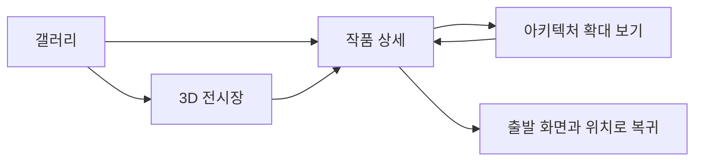
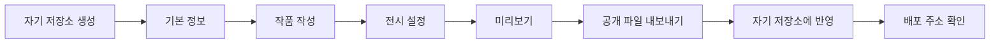

# 포트폴리오 전시장 화면과 개인 설정 상세 기획

관람객의 작품 탐색과 전시장 주인의 콘텐츠 작성을 화면 단위로 정의한다. 갤러리, 3D 전시장과 작품 상세는 공통 콘텐츠를 사용하며, 설정 화면은 별도 작업 공간이다. 각 사용자는 템플릿을 복제하고 자신의 저장소에서 공개 사이트를 운영한다.

이 문서는 [플랫폼 상세 기획](./portfolio-plan.md)의 화면 배치와 동작을 구체화한 초안이다. 와이어프레임은 배치와 흐름을 검토하는 용도이며, 실제 YouTube 재생이나 3D 공간을 구현한 결과가 아니다.

## 화면 목록

| 구분 | 화면 | 주요 목적 |
| --- | --- | --- |
| 관람 | 갤러리 | 전시장 주인과 작품 파악 |
| 관람 | 3D 전시장 | 공간을 탐색하며 작품 선택 |
| 관람 | 작품 상세 | 플레이, 역할과 개발 과정 확인 |
| 관람 | 아키텍처 확대 보기 | 구조와 시스템 설명 탐색 |
| 제작 | 기본 정보 | 이름과 개인 전시장 설정 |
| 제작 | 작품 목록과 편집 | 작품 내용과 공개 대상 관리 |
| 제작 | 전시 설정과 미리보기 | 테마, 순서와 공간 배치 확인 |
| 제작 | 내보내기와 배포 안내 | 파일 생성과 공개 절차 확인 |

작품 상세의 영상, 역할, 그래프와 개발 기록은 한 문서 안에 배치한다. 섹션 이동을 제공하되 각각 별도 페이지로 나누지 않는다. 그래프는 상세 안의 간략한 보기와 넓게 펼친 보기를 제공한다.

## 두 가지 기본 흐름





관람객에게 편집 메뉴를 보여주지 않는다. 전시장 주인은 별도의 설정 주소에서 작업한다. 이름과 작품 입력은 로컬 초안에 반영되고 공개 파일과 공개 사이트는 내보내기 및 배포 이후 바뀐다.

## 갤러리 화면

### 데스크톱 배치

```text
전시장 이름                      갤러리  3D 전시장  소개

표시 이름과 소개
개발 관심 분야                         3D 전시장 입장

전시 작품
표지                 표지                 표지
작품명               작품명               작품명
장르와 담당 역할     장르와 담당 역할     장르와 담당 역할

전시장 주인 소개와 공개 링크
```

처음 보이는 영역에서 개인 이름과 최소 한 작품을 확인한다. 카드에 이름, 장르와 역할을 항상 표시한다. 대표작을 크게 강조하는 별도 레이아웃은 첫 버전에서 추가하지 않고 전시 순서로 우선순위를 표현한다.

### 모바일 배치

상단은 전시장 이름과 갤러리 및 3D 모드 전환으로 줄인다. 소개는 짧게 표시하고 작품 카드는 한 열로 나열한다. 소개와 공개 링크는 아래쪽에 둔다. 작품 수가 많아도 본문을 가로 스크롤하지 않는다.

### 동작과 상태

| 대상 | 동작 | 상태와 복귀 |
| --- | --- | --- |
| 작품 카드 | 작품 상세로 이동 | 목록의 스크롤과 출발 작품 기록 |
| 3D 전시장 입장 | 공간 자원 로드 후 입구 표시 | 실패하면 갤러리로 계속 관람 |
| 소개 메뉴 | 하단 소개 영역으로 이동 | 작품 선택 상태에 영향 없음 |
| 작품 0개 | 공개 작품을 준비 중이라는 안내 | 예시 작품 자동 생성하지 않음 |
| 작품 1개 | 한 카드로 표시 | 카드 폭이 화면 전체로 과도하게 늘어나지 않음 |
| 작품 여러 개 | 설정 순서대로 행 확장 | 제목과 ID가 바뀌어도 링크 정책 유지 |

## 작품 상세 화면

### 데스크톱 배치

```text
전시장 이름                                   관람 화면으로 돌아가기
작품명                         장르  역할  기간

본문                                           섹션 이동
  플레이 영상                                 소개와 영상
  게임 소개                                   담당 역할
  제작 정보                                   아키텍처
  담당 역할                                   문제 해결
  아키텍처 간략 보기                           회고와 자료
  문제 해결 사례
  결과와 회고
  코드와 문서 링크

이전 작품                                      다음 작품
```

섹션 이동은 본문 위치를 바꾸며 콘텐츠를 숨기는 탭으로 만들지 않는다. 제작 정보가 없으면 해당 값만 준비 중으로 표시한다. 사용자가 정보를 입력하지 않은 선택 섹션은 공개 화면에서 생략할 수 있다.

### 모바일 배치

작품명과 역할을 상단에 두고 영상부터 한 열로 표시한다. 섹션 이동은 줄바꿈 가능한 버튼으로 배치한다. 돌아가기와 자료 링크를 작은 아이콘에만 의존하지 않는다. 영상 플레이어 폭은 화면에 맞추고 비율은 유지한다.

### 동작과 상태

영상 재생은 명시적인 선택으로 시작한다. 작품을 떠나면 영상 재생을 종료한다. 그래프 확대 보기에서는 영상이 계속 재생되지 않도록 일시 중지한다. 이전 및 다음 작품 이동은 현재 관람 모드의 복귀 대상을 유지한다.

갤러리에서 열었으면 같은 작품 카드와 스크롤 위치로 돌아간다. 3D에서 열었으면 같은 전시실과 시점으로 돌아간다. 상세 주소를 직접 열었으면 돌아가기의 기본 대상은 갤러리다.

## 3D 전시장 화면

### 데스크톱 배치

```text
전시장 이름             갤러리  3D 전시장             조작 도움말

                  3D 공간 관람 영역
       전시 구역                 전시 구역
                  중앙 로비
                         전시 구역

선택한 작품명과 한 줄 소개                     작품 상세 보기
작품 바로가기                                 입구로 돌아가기
```

작품 바로가기는 드래그나 공간 조작 없이도 각 구역을 선택할 수 있게 한다. 작품 패널 선택 시 작품명을 확인하고 상세를 여는 방식을 사용한다. 공간의 바닥 이동 지점과 작품 패널의 역할이 시각적으로 구분되어야 한다.

첫 버전은 드래그로 시점을 바꾸고 이동 지점을 선택하는 방식이다. 이동 중에는 중복 이동 요청을 정리하고, 동작 줄이기 설정에서는 즉시 도착한다. 작품을 선택하기 위해 정밀한 마우스 조작을 요구하지 않는다.

### 모바일 배치

공간 아래에 작품 선택 목록과 상세 보기 버튼을 둔다. 공간 위에 작은 버튼을 여러 개 겹치지 않는다. 페이지 스크롤과 공간 드래그가 충돌하지 않도록 공간 영역 안에서만 조작을 처리한다.

### 상태

| 상태 | 표시 | 행동 |
| --- | --- | --- |
| 최초 로딩 | 공간 로딩 안내 | 갤러리 이동 가능 |
| 정상 관람 | 작품 패널과 바로가기 | 시점 변경, 이동과 작품 선택 |
| 작품 선택 | 선택한 작품의 이름과 역할 | 상세 보기 또는 다른 작품 선택 |
| 다른 방 | 방 번호와 등록 작품 목록 | 방 선택과 로비 복귀 |
| 상세 열림 | 일반 상세 화면 | 공간 렌더링과 입력 중지 |
| 실행 실패 | 설명과 복구 버튼 | 다시 시도 또는 갤러리 |

## 아키텍처 확대 보기

### 데스크톱 배치

```text
작품명과 아키텍처                         상세로 돌아가기
2D 보기  3D 보기         내 담당 강조      전체 맞춤

그래프 영역                         선택한 시스템 설명
  그룹과 노드                         책임
  방향과 관계 라벨                    입력과 출력
                                      개인 기여
                                      연결 이유
                                      문제 해결 사례
                                      관련 코드

관계 범례와 기준 버전
```

동일한 노드와 연결을 2D 및 3D로 표시한다. 전환 시 선택한 노드와 개인 기여 강조 설정을 유지하고 카메라 배치는 모드별로 관리한다. 3D를 지원하지 않으면 2D와 시스템 목록을 유지한다.

### 모바일 배치

그래프, 시스템 선택 목록과 설명을 순서대로 둔다. 노드 선택 시 설명이 바뀌지만 읽고 있던 위치를 갑자기 화면 밖으로 이동시키지 않는다. 설명으로 이동하는 버튼은 별도로 제공할 수 있다.

처음에는 전체 구조를 표시한다. 선택 시 해당 노드와 직접 연결된 관계를 강조한다. 관계의 뜻은 색과 함께 라벨 및 방향으로 표시한다. 노드가 없는 작품은 준비 중 상태로 표시한다.

실제 시스템 구조가 아직 없으므로 와이어프레임의 시스템 A, B 등의 노드는 기획용 예시다. 각 작품의 실제 구조로 해석하지 않는다.

## 기본 정보 설정 화면

### 공통 작업 공간

```text
전시장 설정                       이 기기에 초안 저장  미리보기

단계 메뉴              입력 영역                    반영 미리보기
기본 정보                표시 이름                  전시장 제목
작품                     전시장 이름                이름과 소개
전시 설정                자기소개                   공개 링크
내보내기                 관심 분야
                         공개 링크

초안 상태와 저장 위치                              다음 단계
```

표시 이름과 전시장 이름은 별도 입력이다. 자기소개, 이미지와 공개 링크는 선택 사항이다. 입력 즉시 오른쪽 미리보기에 반영하되 공개 사이트가 바뀌었다고 표시하지 않는다.

모바일은 단계 메뉴를 줄바꿈 가능한 단계 선택으로 바꾸고 입력 아래에 미리보기를 둔다. 필수 항목 오류는 해당 필드 아래에 표시한다. 오류를 고쳐도 나머지 입력은 보존한다.

### 저장과 페이지 이동

초안 저장은 이 브라우저에 저장한다. 저장하지 않은 변경이 있을 때 브라우저를 떠나면 변경 내용을 잃을 수 있음을 알려준다. 단계 전환은 입력을 유지하며, 관람 미리보기로 갔다가 돌아와도 편집 중인 작품과 값이 남아 있어야 한다.

## 작품 관리와 편집 화면

### 목록

작품명, 장르, 공개 상태, 영상 등록 상태와 편집 버튼을 표시한다. 첫 버전에서는 위로 및 아래로 이동 버튼으로 순서를 변경한다. 순서 변경은 갤러리와 3D 전시장에 함께 반영한다.

| 조작 | 동작 |
| --- | --- |
| 작품 추가 | 새 ID를 만들고 초안 편집 화면 열기 |
| 편집 | 기존 ID를 유지하고 내용 수정 |
| 순서 변경 | 목록 순서와 전시 순서 함께 변경 |
| 공개 대상으로 선택 | 공개 미리보기와 내보내기에 포함 |
| 작품 삭제 | 작품명과 삭제 범위를 확인한 뒤 초안에서 제거 |
| 공개 작품 0개 | 빈 전시장 미리보기와 콘텐츠 등록 안내 |

삭제는 공개 서버에서 즉시 삭제하는 동작이 아니다. 내보내기와 재배포 이후 공개 사이트에 반영된다. 마지막 작품도 삭제할 수 있지만, 공개할 콘텐츠가 없는 상태를 분명하게 표시한다.

### 편집

작품 개요, 제작 정보, 미디어, 개인 기여, 개발 기록과 아키텍처를 나누어 입력한다. 필수값은 작품명과 요약으로 제안한다. 제작 날짜, 영상과 그래프를 등록하지 않아도 초안 저장은 가능하다.

영상 주소 입력은 지원하는 YouTube 주소인지 확인하고 등록 상태를 표시한다. 플레이어 재생 가능 여부는 공개 전 실제 미리보기에서 확인한다. 주소 형식 검증과 실제 재생 검증을 구분한다.

이미지는 파일 선택과 대체 설명 입력으로 등록한다. 선택한 이미지와 참조 경로가 내보내기 패키지에 함께 포함되어야 한다. 첫 버전의 그래프 입력은 시스템 목록과 연결 목록의 폼이다. 연결 대상을 삭제하면 영향을 받는 연결을 알려주고 정리한다.

## 전시 설정과 미리보기 화면

기본 관람 모드, 테마와 작품 순서를 확인한다. 기본 테마는 정해진 색 조합을 제공하며, 모든 색을 자유 입력하는 테마 편집기는 이후 범위로 남긴다.

미리보기는 현재 초안을 사용한다. 공개 상태 확인은 공개 대상으로 선택한 작품만 표시하고, 편집용 전체 확인은 초안 포함 여부를 명시한다. 미리보기 주소를 공유 가능한 공개 주소로 안내하지 않는다.

데스크톱과 모바일 레이아웃을 전환하고 갤러리 및 3D 배치를 확인한다. 작품이 여섯 개를 초과하면 방을 나누는 제안이 이름과 목록 탐색에서도 성립하는지 점검한다.

## 내보내기와 배포 안내 화면

```text
내보내기와 배포

공개할 프로필과 작품 요약
검증 결과와 수정할 항목

공개 콘텐츠 내보내기             전체 초안 백업

1 생성한 파일을 자기 저장소에 반영
2 저장소의 배포 절차 진행
3 실제 공개 주소에서 확인

설정 화면으로 돌아가기
```

공개 콘텐츠 내보내기는 공개 작품과 필요한 이미지 및 그래프만 포함한다. 전체 초안 백업은 초안 작품을 포함하며 배포 패키지와 명칭 및 용도를 구분한다.

| 결과 | 안내 |
| --- | --- |
| 검증 통과 | 공개 작품 수와 포함 파일 확인 후 내보내기 가능 |
| 필수 정보 오류 | 해당 화면과 필드로 이동 |
| 선택 자료 미등록 | 빠진 항목을 안내하고 내보내기 허용 |
| 내보내기 실패 | 입력을 유지하고 다시 시도 가능 |
| 파일 생성 | 다운로드 완료 상태 표시 |
| 실제 공개 | 사용자가 자기 배포 주소에서 확인 |

파일 생성만으로 공개 완료를 표시하지 않는다. 배포 버튼 하나로 GitHub 저장소를 수정하는 OAuth 연동은 이 단계에 포함하지 않는다. 처음 배포하는 사용자를 위한 템플릿 복제와 Pages 설정 안내를 제공한다.

## 빈 상태와 예외 화면

| 상황 | 표시와 복구 |
| --- | --- |
| 프로필 미입력 | 설정 화면의 필수 정보 안내 |
| 관람 작품 없음 | 전시를 준비 중이라는 안내 |
| 이미지 없음 | 작품 제목을 읽을 수 있는 기본 표지 |
| 영상 없음 | 영상 준비 중 또는 선택 섹션 생략 |
| 그래프 없음 | 구조 자료 준비 중 |
| 작품 주소 없음 | 작품을 찾을 수 없음과 목록 이동 |
| 잘못된 가져오기 파일 | 문제 항목 표시, 현재 초안 유지 |
| 초안 복구 | 저장 날짜와 불러올 내용 확인 |
| 3D 실패 | 다시 시도와 갤러리 선택 |

## 개인화 검증 흐름

첫 전시장에는 확인된 세 작품을 사용한다. 별도 검증용 프로필로 이름과 전시장 제목을 바꾸고 작품 수를 0개, 1개 및 여러 개로 변경한다. 검증용 프로필과 예시는 실제 친구의 경력으로 공개하지 않는다.

다음 조건을 충족해야 화면 설계를 확정한다.

- 개인 이름과 전시장 제목을 바꾸면 관람 화면과 공간 입구가 함께 바뀐다.
- 모든 공개 작품에 갤러리와 3D 바로가기로 접근할 수 있다.
- 상세에서 돌아오면 출발 화면과 선택 위치를 복원한다.
- 그래프 모드를 바꿔도 선택 시스템과 설명이 유지된다.
- 설정에서 입력한 값은 단계 전환과 미리보기 복귀 뒤에도 유지된다.
- 내보내기와 초안 저장을 공개 배포로 오해하지 않는다.
- 모바일과 키보드에서도 주요 동작을 수행할 수 있다.
- 초안, 기획 예시와 공개 콘텐츠의 구분이 명확하다.

## 다음 상세 기획

개인 설정과 작품 및 그래프의 정확한 필드, 저장 형식과 검증 규칙은 [데이터 형식과 입력 검증 기획](./data-contract.md)에 구체화했다.

이 화면 구성 다음에는 개인 설정과 작품 데이터의 정확한 필드, 검증 규칙과 파일 형식을 정의한다. 이후 실제 작품 하나의 콘텐츠를 넣어 시스템 노드와 연결 관계, 영상 및 문제 해결 기록의 표현을 확인한다. 시각 디자인과 3D 모델 제작은 화면 흐름을 검토한 뒤 이어간다.
